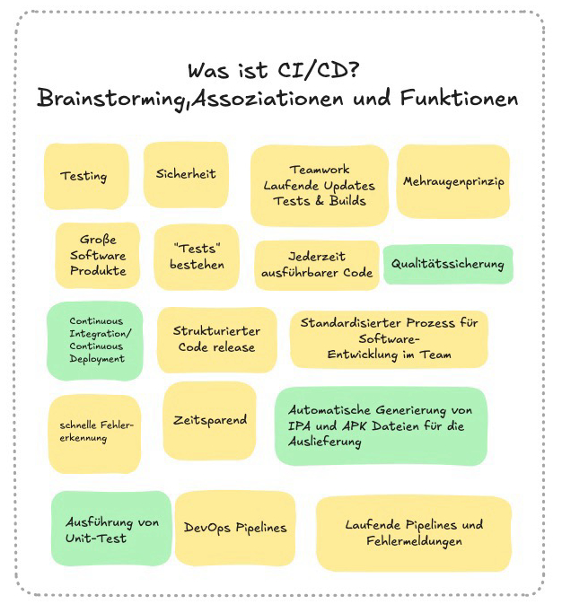
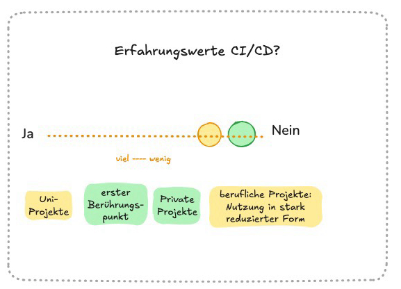
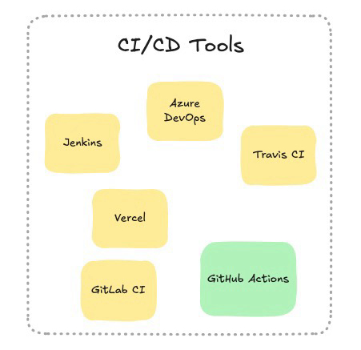

# Übung 2: CI/CD

Zum Einstieg haben wir im Team ein Brainstorming mit [Excalidraw](https://excalidraw.com) durchgeführt.
Die Ergebnisse halten wir in dieser README fest.

## 1. Einführung in CI/CD

### (a) Grundlegende Konzepte

- **Continuous Integration (CI):** Jede Änderung wird regelmäßig in den gemeinsamen Branch integriert und automatisch gebaut und getestet
- **Continuous Deployment (CD):** Jeder erfolgreiche Build wird automatisch ausgeliefert, der Code ist dadurch jederzeit ausführbar

Weitere Assoziationen aus dem Brainstorming: Qualitätssicherung, Sicherheit, Mehraugenprinzip, strukturierter Code-Release und ein standardisierter Prozess im Team.

*Abbildung 1: Brainstorming zur Frage "Was ist CI/CD?"*

### (b) Unterstützung der Softwareentwicklung

- Fehler werden durch automatische Tests früh erkannt, das spart Zeit
- Bei jedem Push bzw. Pull Request laufen Build und Unit-Tests in einer Pipeline, nur grüne Änderungen werden gemergt
- Laufende Pipelines liefern direkte Fehlermeldungen an das Team

**Erfahrungswerte:** Im Team bisher wenig, vor allem aus Uni-, privaten und teilweise ersten beruflichen Projekten.

*Abbildung 2: Erfahrungswerte des Teams mit CI/CD*

**Bekannte Tools:** Jenkins, Azure DevOps, Travis CI, Vercel, GitLab CI und GitHub Actions.

*Abbildung 3: Bekannte CI/CD-Tools*

## 4. Deployment-Konzepte

### Möglicher Ablauf

1. Push bzw. Pull Request auf GitHub
2. GitHub Actions baut die Anwendung und führt die Tests aus
3. Nach dem Merge in `main` wird automatisch auf die Zielplattform deployed

Durch diesen Ablauf wird sichergestellt, dass stets nur getesteter und funktionierender Code nach main deployed wird und die Live/Produktionsseite getested ist und funktioniert.

### Relevante Plattformen

| Plattform | Vorteile | Nachteile |
|---|---|---|
| GitHub Actions (CI) | Direkt im Repo integriert, kostenlos für öffentliche Repos | Bindung an GitHub |
| Jenkins (CI/CD) | Open Source, sehr flexibel durch viele Plugins, selbst gehostet | Eigener Server nötig, aufwendige Einrichtung und Wartung |
| Vercel | Sehr einfaches Setup, Preview-Deployments pro Pull Request | Primär für Web-Frontends, Backend eingeschränkt, Kosten |
| Cloudflare (Pages/Workers) | Großzügiger Free-Tier, globales Edge-Netzwerk, Preview-Deployments pro Pull Request | Eigene Runtime mit Einschränkungen (z. B. nur teilweise Node.js-kompatibel), Bindung an Cloudflare |
| Azure / AWS | Sehr flexibel und skalierbar | Komplexe Konfiguration, Kosten |
| Eigener Server mit Docker | Volle Kontrolle | Hoher Wartungsaufwand |

Wir haben uns für **GitHub Actions** für CI entschieden, da unser Repository bereits auf GitHub liegt.
Die Zielplattform für das Deployment legen wir fest, sobald der Tech-Stack steht.
