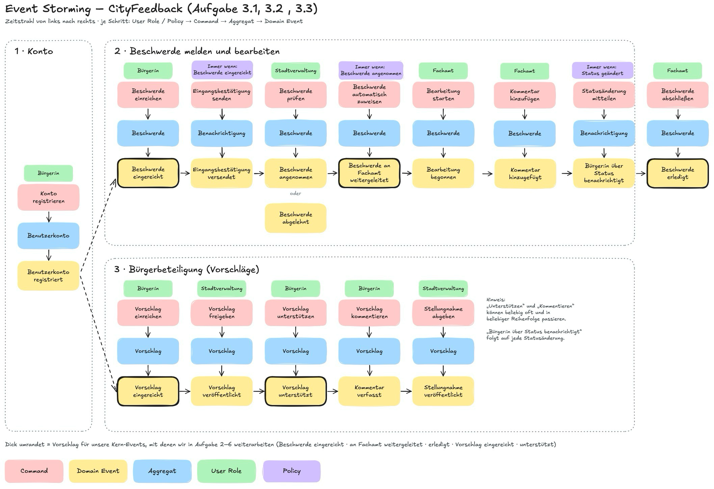
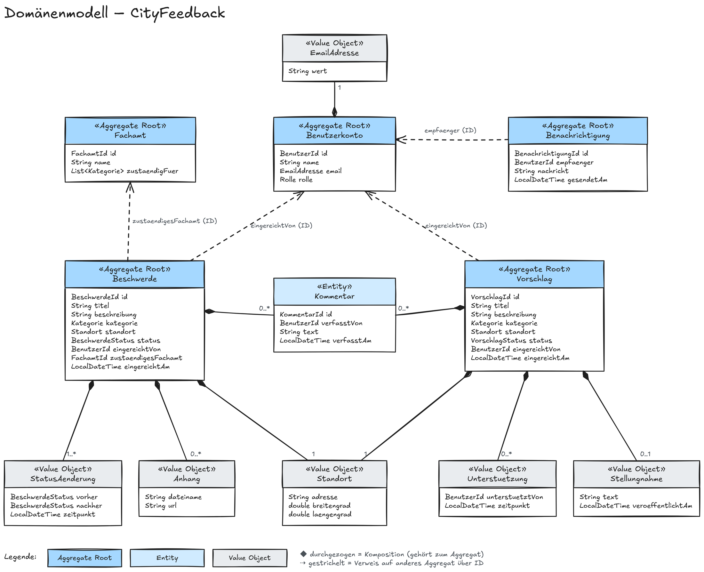
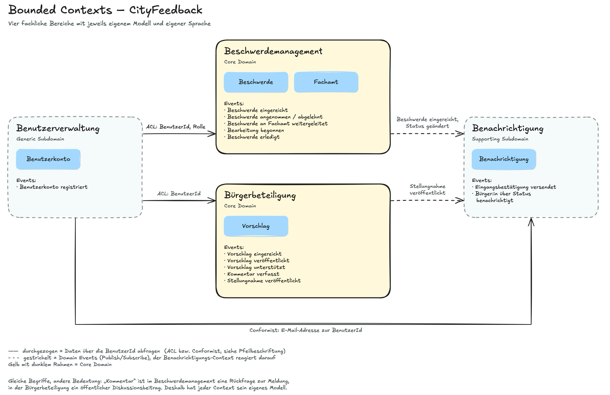

# Übung 3: Systemarchitektur

## 1. Event Storming

Die Event-Storming-Session haben wir auf unserem gemeinsamen Excalidraw-Board durchgeführt. Für die Darstellung nutzen wir fünf Typen von Haftnotizen:

| Farbe | Typ | Bedeutung |
|---|---|---|
| Rot | Command | Aktion, die jemand im System auslöst |
| Gelb | Domain Event | Fachlich relevantes Ereignis, das daraufhin eingetreten ist (immer in der Vergangenheitsform) |
| Blau | Aggregat | Objekt, auf das sich der Command bezieht und das das Event erzeugt |
| Grün | User Role | Person oder Rolle, die den Command auslöst |
| Lila | Policy | Regel, die automatisch auf ein Domain Event reagiert und den nächsten Command auslöst („Immer wenn ..., dann ...“) |

Jeder Schritt liest sich von oben nach unten: Eine Rolle löst einen Command aus, der Command wird von einem Aggregat verarbeitet und daraus entsteht ein Domain Event. Von links nach rechts ergibt sich die zeitliche Reihenfolge. Eine Policy ist keine Rolle: Sie steht für eine Regel, die ohne menschliches Zutun auf ein Event reagiert und daraus den nächsten Command auslöst.



*Abbildung 1: Event Storming für CityFeedback*

### Geschäftsprozesse und Reihenfolge der Events

Die Registrierung ist die Voraussetzung für beide fachlichen Prozesse. Danach teilt sich das System in zwei Abläufe: das Melden und Bearbeiten von Beschwerden und die Bürgerbeteiligung über Vorschläge.

**Prozess 1: Konto**

| Nr. | User Role | Command | Aggregat | Domain Event |
|---|---|---|---|---|
| 1 | Bürger:in | Konto registrieren | Benutzerkonto | Benutzerkonto registriert |

**Prozess 2: Beschwerde melden und bearbeiten**

| Nr. | User Role / Policy | Command | Aggregat | Domain Event |
|---|---|---|---|---|
| 2 | Bürger:in | Beschwerde einreichen | Beschwerde | Beschwerde eingereicht |
| 3 | Policy: immer wenn „Beschwerde eingereicht“ | Eingangsbestätigung senden | Benachrichtigung | Eingangsbestätigung versendet |
| 4 | Stadtverwaltung | Beschwerde prüfen | Beschwerde | Beschwerde angenommen oder Beschwerde abgelehnt |
| 5 | Stadtverwaltung | Beschwerde zuweisen | Beschwerde | Beschwerde an Fachamt weitergeleitet |
| 6 | Fachamt | Bearbeitung starten | Beschwerde | Bearbeitung begonnen |
| 7 | Policy: immer wenn sich der Status ändert | Statusänderung mitteilen | Benachrichtigung | Bürger:in über Status benachrichtigt |
| 8 | Fachamt | Beschwerde abschließen | Beschwerde | Beschwerde erledigt |

Die Schritte 3 und 7 werden von keiner Person ausgelöst, sondern von einer Policy, die auf das vorherige Event reagiert. Schritt 7 steht dabei stellvertretend für alle Statusänderungen: Auch nach „angenommen“, „abgelehnt“ und „erledigt“ wird die einreichende Person benachrichtigt.

**Prozess 3: Bürgerbeteiligung (Vorschläge)**

| Nr. | User Role | Command | Aggregat | Domain Event |
|---|---|---|---|---|
| 9 | Bürger:in | Vorschlag einreichen | Vorschlag | Vorschlag eingereicht |
| 10 | Stadtverwaltung | Vorschlag freigeben | Vorschlag | Vorschlag veröffentlicht |
| 11 | Bürger:in | Vorschlag unterstützen | Vorschlag | Vorschlag unterstützt |
| 12 | Bürger:in | Vorschlag kommentieren | Vorschlag | Kommentar verfasst |
| 13 | Stadtverwaltung | Stellungnahme abgeben | Vorschlag | Stellungnahme veröffentlicht |

Unterstützen und Kommentieren können beliebig oft und in beliebiger Reihenfolge passieren, sobald ein Vorschlag veröffentlicht ist.

### Überarbeitung der ersten Sammlung

In der ersten Runde hatten wir vor allem einzelne Schritte im Formular gesammelt. Diese haben wir zusammengefasst, weil ein Domain Event einen fachlichen Zustandswechsel beschreibt und keinen einzelnen Klick in der Oberfläche.

| Erste Sammlung | Überarbeitet |
|---|---|
| Kontaktdaten wurden eingegeben, Art des Formulars wurde ausgewählt, Formular wurde ausgefüllt, Formular wurde gesendet, Formular wurde gespeichert | Beschwerde eingereicht |
| Nutzer registriert sich | Benutzerkonto registriert |
| Stadtverwaltung hat eingereichte Beschwerde geöffnet | Beschwerde angenommen / Beschwerde abgelehnt |
| Stadtverwaltung hat eingereichte Beschwerde geändert | Beschwerde an Fachamt weitergeleitet, Bearbeitung begonnen, Beschwerde erledigt |
| Bearbeitungsstatus wurde angesehen | entfällt (reines Anzeigen ändert keinen Zustand) |
| Benachrichtigung über Status wurde erhalten | Bürger:in über Status benachrichtigt |

### Kern-Events

Für die weiteren Teilaufgaben konzentrieren wir uns auf die folgenden Events (im Bild dick umrandet):

- Beschwerde eingereicht
- Beschwerde an Fachamt weitergeleitet
- Beschwerde erledigt
- Vorschlag eingereicht
- Vorschlag unterstützt

Sie decken beide Kernprozesse ab, vom Einreichen bis zum Abschluss.

## 2. Domänenmodell

Das Domänenmodell leitet sich direkt aus den Aggregaten des Event Stormings ab. Wir unterscheiden dabei drei Arten von Bausteinen:

- **Entität:** hat eine eigene Identität (ID) und kann sich über die Zeit verändern, z. B. eine Beschwerde, deren Status sich ändert.
- **Wert (Value Object):** hat keine eigene Identität und wird nur über seinen Inhalt bestimmt. Zwei Standorte mit gleicher Adresse und gleichen Koordinaten sind derselbe Standort. Werte sind unveränderlich.
- **Aggregat:** fasst Entitäten und Werte zusammen, die immer gemeinsam konsistent sein müssen. Von außen wird nur über die Wurzel (Aggregate Root) zugegriffen. Ein Kommentar zu einer Beschwerde wird also über die Beschwerde hinzugefügt und nicht direkt gespeichert.

| Aggregat (Root) | Enthaltene Entitäten | Enthaltene Werte | Abgeleitet aus den Events |
|---|---|---|---|
| Beschwerde | Kommentar | Standort, Kategorie, Anhang, StatusAenderung | eingereicht, angenommen/abgelehnt, weitergeleitet, Bearbeitung begonnen, erledigt |
| Vorschlag | Kommentar | Standort, Kategorie, Unterstuetzung, Stellungnahme | eingereicht, veröffentlicht, unterstützt, Kommentar verfasst, Stellungnahme veröffentlicht |
| Benutzerkonto | – | EmailAdresse, Rolle | Benutzerkonto registriert |
| Fachamt | – | Kategorie (Zuständigkeit) | Beschwerde an Fachamt weitergeleitet |
| Benachrichtigung | – | – | Eingangsbestätigung versendet, Bürger:in über Status benachrichtigt |

Aggregate verweisen untereinander nur über IDs und nicht über direkte Objektreferenzen. Eine Beschwerde kennt also die `BenutzerId` der einreichenden Person und die `FachamtId` des zuständigen Amts, enthält aber nicht deren ganze Objekte. So bleiben die Aggregate unabhängig voneinander.



*Abbildung 2: Domänenmodell von CityFeedback als Klassendiagramm*

Eine ausgefüllte Raute (Komposition) bedeutet, dass der Teil zum Aggregat gehört und ohne die Wurzel nicht existiert. Ein gestrichelter Pfeil steht für einen Verweis auf ein anderes Aggregat über dessen ID. Die genauen Attribute und Methoden der Entitäten werden in Teilaufgabe 4 ausgearbeitet.

Die festen Wertebereiche haben wir als Aufzählungstypen (Enums) angelegt. Sie stehen der Übersicht halber nicht im Diagramm:

| Aufzählungstyp | Werte |
|---|---|
| Kategorie | STRASSENSCHADEN, BELEUCHTUNG, MUELL, GRUENFLAECHE, VERKEHR, SONSTIGES |
| BeschwerdeStatus | EINGEREICHT, ANGENOMMEN, ABGELEHNT, WEITERGELEITET, IN_BEARBEITUNG, ERLEDIGT |
| VorschlagStatus | EINGEREICHT, VEROEFFENTLICHT, BEANTWORTET |
| Rolle | BUERGER_IN, STADTVERWALTUNG, FACHAMT |

## 3. Bounded Contexts

Aus dem Domänenmodell ergeben sich vier fachliche Bereiche, die jeweils ein eigenes Modell und eine eigene Sprache haben. Die Grenzen haben wir dort gezogen, wo die Events einen anderen Geschäftsprozess oder eine andere Verantwortung betreffen.

| Bounded Context | Verantwortung | Aggregate | Zugehörige Events | Art |
|---|---|---|---|---|
| Beschwerdemanagement | Beschwerden einreichen, prüfen, an Fachämter zuweisen, bearbeiten und abschließen | Beschwerde, Fachamt | Beschwerde eingereicht, angenommen/abgelehnt, an Fachamt weitergeleitet, Bearbeitung begonnen, erledigt | Core Domain |
| Bürgerbeteiligung | Vorschläge einreichen, freigeben, unterstützen, kommentieren und beantworten | Vorschlag | Vorschlag eingereicht, veröffentlicht, unterstützt, Kommentar verfasst, Stellungnahme veröffentlicht | Core Domain |
| Benutzerverwaltung | Registrierung, Anmeldung und Rollen (Bürger:in, Stadtverwaltung, Fachamt) | Benutzerkonto | Benutzerkonto registriert | Generic Subdomain |
| Benachrichtigung | Bürger:innen über Eingang und Statusänderungen informieren | Benachrichtigung | Eingangsbestätigung versendet, Bürger:in über Status benachrichtigt | Supporting Subdomain |

Die beiden Core Domains sind das, was CityFeedback ausmacht. Benutzerverwaltung und Benachrichtigung werden zwar gebraucht, sind aber keine Besonderheit unseres Projekts und könnten auch mit fertigen Lösungen umgesetzt werden.

### Beziehungen zwischen den Contexts



*Abbildung 3: Bounded Contexts und ihre Beziehungen (durchgezogen: Abfrage von Daten über ACL bzw. Conformist, gestrichelt: Domain Events)*

| Von (Upstream) | Nach (Downstream) | Art der Beziehung | Was ausgetauscht wird |
|---|---|---|---|
| Benutzerverwaltung | Beschwerdemanagement | Anti-Corruption Layer | BenutzerId und Rolle der angemeldeten Person |
| Benutzerverwaltung | Bürgerbeteiligung | Anti-Corruption Layer | BenutzerId der angemeldeten Person |
| Benutzerverwaltung | Benachrichtigung | Conformist | E-Mail-Adresse zur BenutzerId |
| Beschwerdemanagement | Benachrichtigung | Domain Events (Publish/Subscribe) | Beschwerde eingereicht, Statusänderungen, Beschwerde erledigt |
| Bürgerbeteiligung | Benachrichtigung | Domain Events (Publish/Subscribe) | Stellungnahme veröffentlicht |

Weil die Benutzerverwaltung eine austauschbare Generic Subdomain ist, passt ein Customer/Supplier-Verhältnis nicht: Die Downstream-Contexts hätten keinen Einfluss auf das Modell des Lieferanten. Stattdessen entscheiden wir je nach Wert des Downstream-Contexts:

- **Anti-Corruption Layer für die beiden Core Domains:** Beschwerdemanagement und Bürgerbeteiligung dürfen nicht vom Modell der Benutzerverwaltung abhängen. Eine Übersetzungsschicht im jeweiligen Context holt das Benutzerkonto ab und bildet es auf die eigenen Begriffe ab: Im Beschwerdemanagement wird daraus nur eine `BenutzerId` und die Information, ob die Person für die Stadtverwaltung oder ein Fachamt handelt, in der Bürgerbeteiligung nur eine `BenutzerId`. Ändert sich das Benutzermodell oder wird die Benutzerverwaltung ausgetauscht, muss nur diese Schicht angepasst werden.
- **Conformist für die Benachrichtigung:** Der Benachrichtigungs-Context ist eine Supporting Subdomain und braucht nur die E-Mail-Adresse zu einer `BenutzerId`. Er übernimmt das Modell der Benutzerverwaltung unverändert. Eine eigene Übersetzungsschicht wäre hier Aufwand ohne fachlichen Nutzen.

Das Beschwerdemanagement und die Bürgerbeteiligung schicken keine Nachrichten selbst. Sie veröffentlichen nur ihre Events, und der Benachrichtigungs-Context entscheidet, wer worüber informiert wird. Dadurch können wir später zum Beispiel eine Push-Benachrichtigung ergänzen, ohne die Kernlogik anzufassen.

### 3.1. Kontextabhängige Fachbegriffe (Ubiquitous Language)

Die Trennung zeigt sich auch daran, dass manche Begriffe in den Contexts etwas anderes bedeuten:

| Begriff | Beschwerdemanagement | Bürgerbeteiligung | Benutzerverwaltung |
|---|---|---|---|
| Kommentar | Rückfrage oder Hinweis zu einer konkreten Meldung, nur für Beteiligte sichtbar | Öffentlicher Diskussionsbeitrag zu einem Vorschlag | – |
| Benutzer:in | Einreichende Person, nur über die BenutzerId bekannt | Einreichende oder unterstützende Person, nur über die BenutzerId bekannt | Vollständiges Konto mit Name, E-Mail und Rolle |
| Status | Bearbeitungsstand der Beschwerde (eingereicht bis erledigt) | Stand des Vorschlags (eingereicht, veröffentlicht, beantwortet) | – |

Deshalb bekommt jeder Context in der Implementierung sein eigenes Modell, auch wenn die Klassen ähnlich heißen. Für die Benutzer:in ist das genau die Aufgabe des Anti-Corruption Layers aus dem vorherigen Abschnitt: Er übersetzt das vollständige Konto der Benutzerverwaltung in die reduzierte Sicht der beiden Core Domains.

## 4. Entitäten und Aggregates

Die Attribute stammen aus dem Domänenmodell (Teilaufgabe 2, Abbildung 2), die Typen `Kategorie`, `BeschwerdeStatus` und `VorschlagStatus` sind die dort definierten Enums.
Die Methoden entsprechen den Commands aus dem Event Storming (Teilaufgabe 1).
Jede Methode prüft den aktuellen Status und erzeugt das passende Domain Event.
`einreichen(...)` ist dabei eine statische Factory-Methode: Sie ist der einzige Weg, ein neues Aggregat zu erzeugen, und stellt sicher, dass es vollständig und im Status `EINGEREICHT` entsteht. Der Konstruktor ist privat.

### 4.1. Bounded Context Beschwerdemanagement

| Baustein | Art | Attribute | Methoden |
|---|---|---|---|
| Beschwerde | Aggregate Root | `BeschwerdeId id`, `String titel`, `String beschreibung`, `Kategorie kategorie`, `Standort standort`, `BeschwerdeStatus status`, `BenutzerId eingereichtVon`, `FachamtId zustaendigesFachamt`, `LocalDateTime eingereichtAm`, `List<Anhang> anhaenge`, `List<StatusAenderung> statusAenderungen`, `List<Kommentar> kommentare` | `static einreichen(BenutzerId, String titel, String beschreibung, Kategorie, Standort)`, `annehmen()`, `ablehnen()`, `weiterleiten(FachamtId)`, `bearbeitungStarten()`, `abschliessen()`, `kommentieren(BenutzerId, String)` |
| Kommentar | Entity (Teil der Beschwerde) | `KommentarId id`, `BenutzerId verfasstVon`, `String text`, `LocalDateTime verfasstAm` | – |
| Fachamt | Aggregate Root | `FachamtId id`, `String name`, `List<Kategorie> zustaendigFuer` | `istZustaendigFuer(Kategorie)` |

Die Reihenfolge der Methoden folgt Prozess 2 aus Teilaufgabe 1: Eine Beschwerde kann nur weitergeleitet werden, wenn sie angenommen ist, und nur abgeschlossen werden, wenn sie in Bearbeitung ist.
Jede Statusänderung wird als `StatusAenderung` gespeichert.

### 4.2. Bounded Context Bürgerbeteiligung

| Baustein | Art | Attribute | Methoden |
|---|---|---|---|
| Vorschlag | Aggregate Root | `VorschlagId id`, `String titel`, `String beschreibung`, `Kategorie kategorie`, `Standort standort`, `VorschlagStatus status`, `BenutzerId eingereichtVon`, `LocalDateTime eingereichtAm`, `List<Unterstuetzung> unterstuetzungen`, `List<Kommentar> kommentare`, `Stellungnahme stellungnahme` | `static einreichen(BenutzerId, String titel, String beschreibung, Kategorie, Standort)`, `freigeben()`, `unterstuetzen(BenutzerId)`, `kommentieren(BenutzerId, String)`, `stellungnahmeAbgeben(String)` |
| Kommentar | Entity (Teil des Vorschlags) | `KommentarId id`, `BenutzerId verfasstVon`, `String text`, `LocalDateTime verfasstAm` | – |

Wie in Prozess 3 aus Teilaufgabe 1 ist Unterstützen und Kommentieren erst nach der Freigabe möglich, und jede Person kann einen Vorschlag nur einmal unterstützen.

Benutzerkonto und Benachrichtigung gehören zu den unterstützenden Contexts und werden direkt wie im Domänenmodell (Teilaufgabe 2) übernommen.

### 4.3. Beziehungen zwischen den Aggregaten

Wie in Teilaufgabe 2 beschrieben, verweisen Aggregate nur über IDs aufeinander, Entitäten und Werte gehören fest zu ihrem Aggregat.

```
Beschwerde
 ├── eingereichtVon (BenutzerId) ──> Benutzerkonto
 ├── zustaendigesFachamt (FachamtId) ──> Fachamt
 └── enthält: Kommentare, Anhänge, Statusänderungen, Standort

Vorschlag
 ├── eingereichtVon (BenutzerId) ──> Benutzerkonto
 └── enthält: Kommentare, Unterstützungen, Stellungnahme, Standort
```

## 5. Domain Services und Repositories

### 5.1. Repositories

Pro Aggregate Root aus Teilaufgabe 4 gibt es genau ein Repository.

| Repository | Context | Methoden |
|---|---|---|
| BeschwerdeRepository | Beschwerdemanagement | `speichern(Beschwerde)`, `findeNachId(BeschwerdeId)`, `findeNachEinreicher(BenutzerId)`, `findeNachFachamt(FachamtId)` |
| FachamtRepository | Beschwerdemanagement | `findeNachId(FachamtId)`, `findeNachKategorie(Kategorie)` |
| VorschlagRepository | Bürgerbeteiligung | `speichern(Vorschlag)`, `findeNachId(VorschlagId)`, `findeVeroeffentlichte()` |
| BenutzerkontoRepository | Benutzerverwaltung | `speichern(Benutzerkonto)`, `findeNachId(BenutzerId)`, `findeNachEmail(EmailAdresse)` |
| BenachrichtigungRepository | Benachrichtigung | `speichern(Benachrichtigung)`, `findeNachEmpfaenger(BenutzerId)` |

### 5.2. Domain Services

Domain Services enthalten Fachregeln, die zu keinem einzelnen Aggregat gehören.

| Domain Service | Context | Aufgabe |
|---|---|---|
| ZuweisungsService | Beschwerdemanagement | Sucht das Fachamt für die Kategorie der Beschwerde und ruft `beschwerde.weiterleiten(fachamtId)` auf |
| RegistrierungsService | Benutzerverwaltung | Prüft, ob die E-Mail-Adresse noch frei ist, und legt das Benutzerkonto an |

### 5.3. Anwendungsservice im Context Benachrichtigung

Der BenachrichtigungsService enthält keine Fachregel, sondern koordiniert nur den Ablauf. Er ist deshalb ein Anwendungsservice und kein Domain Service. Den Versand übernimmt der Port `MailVersand`, damit die Domäne nicht vom Mail-Provider abhängt.

| Anwendungsservice | Context | Aufgabe |
|---|---|---|
| BenachrichtigungsService | Benachrichtigung | Reagiert auf die Domain Events aus Teilaufgabe 3, holt die E-Mail-Adresse zur `BenutzerId`, speichert die `Benachrichtigung` und übergibt sie an den Port `MailVersand` |

## 6. Implementierungsstrategie

### 6.1. Technische Annahmen

- Java-Framework: Spring Boot
- Build-Automation: Maven
- Testing: JUnit
- CI/CD: GitHub Actions
- DB: NoSQL (tbd.)
- UI: HTML, JavaScript/TypeScript (React.js)
- Build und Test mit GitHub Actions, Deployment des Frontends auf GitHub Pages

### 6.2. Vorgehen

Jeder Bounded Context aus Teilaufgabe 3 wird ein eigenes Package. `buergerbeteiligung` und `benutzerverwaltung` sind genauso aufgebaut wie `beschwerdemanagement`, `benachrichtigung` hat statt eines Domain Service einen Anwendungsservice und einen zweiten Port:

```
de.cityfeedback
 ├── beschwerdemanagement
 │    ├── domain          (Beschwerde, Kommentar, Fachamt, Events, BeschwerdeRepository als Port)
 │    ├── service         (ZuweisungsService)
 │    └── infrastructure  (Spring-Data-Adapter für BeschwerdeRepository)
 ├── buergerbeteiligung
 ├── benutzerverwaltung
 └── benachrichtigung
      ├── domain          (Benachrichtigung, BenachrichtigungRepository und MailVersand als Ports)
      ├── application     (BenachrichtigungsService)
      └── infrastructure  (Spring-Data-Adapter für BenachrichtigungRepository, SMTP-Adapter für MailVersand)
```

1. **Entitäten und Aggregate:** Eine Java-Klasse pro Entität und Aggregat mit den Attributen und Methoden aus Teilaufgabe 4, dabei gibt es keine Framework-Abhängigkeiten.
2. **Repositories:** Ein Interface pro Aggregate Root aus Teilaufgabe 5.1 als Port in der Domäne, ohne Framework-Abhängigkeit. Die Umsetzung mit Spring Data liegt als Adapter im Package `infrastructure`.
3. **Domain Services:** Eine Klasse pro Service aus Teilaufgabe 5.2, die Aggregate über die Repositories lädt und speichert.
4. **Anwendungsservice:** Der BenachrichtigungsService aus Teilaufgabe 5.3 als Spring-Event-Listener, der den Port `MailVersand` nutzt. Der SMTP-Adapter liegt im Package `infrastructure`.
5. **Domain Events:** Zum Beispiel `BeschwerdeEingereicht` und `BeschwerdeWeitergeleitet`, auf die der Context Benachrichtigung reagiert.
6. **Tests:** Unit-Tests mit JUnit für die Aggregate (ohne Spring), Integrationstests mit `@SpringBootTest` für Services und Repositories. Beim BenachrichtigungsService wird der Port `MailVersand` im Test durch einen Fake ersetzt, damit keine echten Mails verschickt werden.

### 6.3. Codebeispiel

```java
// Aggregat: Beschwerde
// Das Code-Beispiel ist reines Java (ohne Framework), daher direkt mit JUnit testbar.
// Die Geschäftsregeln (z. B. nur angenommene Beschwerden weiterleiten) liegen im Aggregat selbst.
public class Beschwerde {
  private final BeschwerdeId id;
  private final Kategorie kategorie;
  private BeschwerdeStatus status;
  private FachamtId zustaendigesFachamt;
  private final List<StatusAenderung> statusAenderungen = new ArrayList<>();
  // Clock wird injiziert statt LocalDateTime.now() direkt aufzurufen,
  // damit Tests eine feste Zeit vorgeben können (Clock.fixed(...))
  private final Clock clock;
  // weitere Attribute siehe Teilaufgabe 4

  // Der Konstruktor ist privat: Eine Beschwerde entsteht nur über einreichen(...)
  private Beschwerde(BeschwerdeId id, Kategorie kategorie, Clock clock) {
    this.id = id;
    this.kategorie = kategorie;
    this.clock = clock;
    this.status = BeschwerdeStatus.EINGEREICHT;
  }

  // Factory-Methode: liefert ein vollständiges Aggregat im Startzustand
  public static Beschwerde einreichen(Kategorie kategorie, Clock clock) {
    return new Beschwerde(BeschwerdeId.neu(), kategorie, clock);
  }

  public void weiterleiten(FachamtId fachamtId) {
    if (status != BeschwerdeStatus.ANGENOMMEN) {
      throw new IllegalStateException("Nur angenommene Beschwerden können weitergeleitet werden");
    }
    zustaendigesFachamt = fachamtId;
    // Jeder Statuswechsel wird für die Historie gespeichert
    statusAenderungen.add(new StatusAenderung(status, BeschwerdeStatus.WEITERGELEITET, LocalDateTime.now(clock)));
    status = BeschwerdeStatus.WEITERGELEITET;
  }
}

```

## Aufgabenverteilung – Übung 3

| Teammitglied | Übernommene Aufgaben |
|---|---|
| Maria Lorenz | Teilaufgabe 1 gemeinsam mit dem Team, Teilaufgabe 4 |
| Jesse Khala | Teilaufgabe 1 gemeinsam mit dem Team, Teilaufgaben 5 und 6 |
| Yara Abdullah | Teilaufgabe 1 gemeinsam mit dem Team, Überarbeitung & Zusammenfassung, Teilaufgaben 2 und 3 |
