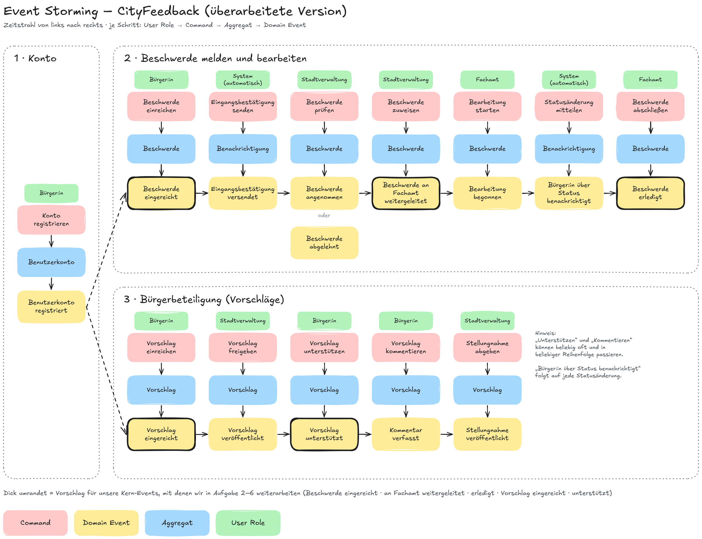
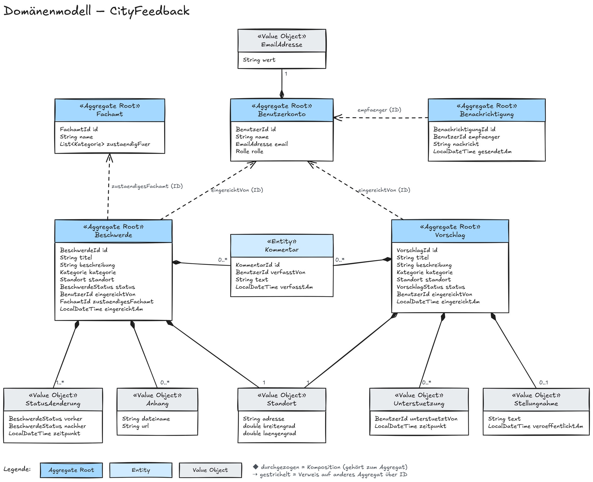
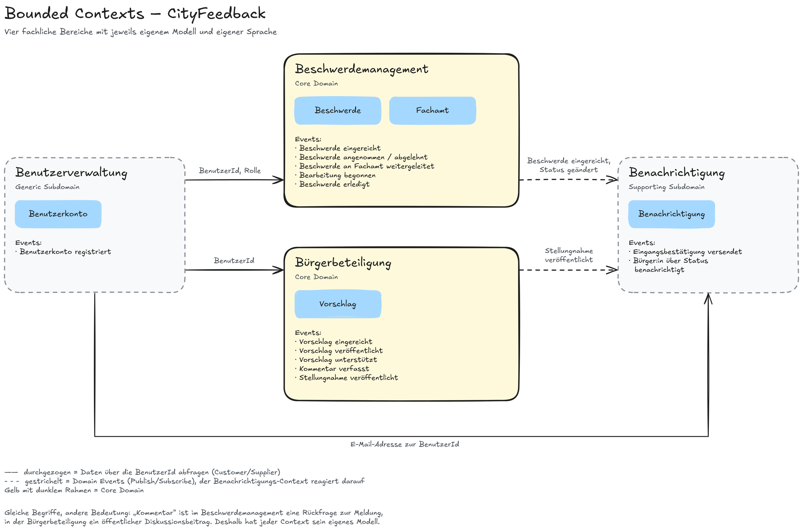

# Übung 3: Systemarchitektur

## 1. Event Storming
<!-- Maria, Jesse, Yara finalisiert -->

Die Event-Storming-Session haben wir auf unserem gemeinsamen Excalidraw-Board durchgeführt. Für die Darstellung nutzen wir vier Typen von Haftnotizen:

| Farbe | Typ | Bedeutung |
|---|---|---|
| Rot | Command | Aktion, die jemand im System auslöst |
| Gelb | Domain Event | Fachlich relevantes Ereignis, das daraufhin eingetreten ist (immer in der Vergangenheitsform) |
| Blau | Aggregat | Objekt, auf das sich der Command bezieht und das das Event erzeugt |
| Grün | User Role | Person oder Rolle, die den Command auslöst |

Jeder Schritt liest sich von oben nach unten: Eine Rolle löst einen Command aus, der Command wird von einem Aggregat verarbeitet und daraus entsteht ein Domain Event. Von links nach rechts ergibt sich die zeitliche Reihenfolge.

*Abbildung 1: Event Storming für CityFeedback*

### Geschäftsprozesse und Reihenfolge der Events

Die Registrierung ist die Voraussetzung für beide fachlichen Prozesse. Danach teilt sich das System in zwei Abläufe: das Melden und Bearbeiten von Beschwerden und die Bürgerbeteiligung über Vorschläge.

**Prozess 1: Konto**

| Nr. | User Role | Command | Aggregat | Domain Event |
|---|---|---|---|---|
| 1 | Bürger:in | Konto registrieren | Benutzerkonto | Benutzerkonto registriert |

**Prozess 2: Beschwerde melden und bearbeiten**

| Nr. | User Role | Command | Aggregat | Domain Event |
|---|---|---|---|---|
| 2 | Bürger:in | Beschwerde einreichen | Beschwerde | Beschwerde eingereicht |
| 3 | System (automatisch) | Eingangsbestätigung senden | Benachrichtigung | Eingangsbestätigung versendet |
| 4 | Stadtverwaltung | Beschwerde prüfen | Beschwerde | Beschwerde angenommen oder Beschwerde abgelehnt |
| 5 | Stadtverwaltung | Beschwerde zuweisen | Beschwerde | Beschwerde an Fachamt weitergeleitet |
| 6 | Fachamt | Bearbeitung starten | Beschwerde | Bearbeitung begonnen |
| 7 | System (automatisch) | Statusänderung mitteilen | Benachrichtigung | Bürger:in über Status benachrichtigt |
| 8 | Fachamt | Beschwerde abschließen | Beschwerde | Beschwerde erledigt |

Schritt 7 steht stellvertretend für alle Statusänderungen: Auch nach „angenommen“, „abgelehnt“ und „erledigt“ wird die einreichende Person benachrichtigt.

**Prozess 3: Bürgerbeteiligung (Vorschläge)**

| Nr. | User Role | Command | Aggregat | Domain Event |
|---|---|---|---|---|
| 9 | Bürger:in | Vorschlag einreichen | Vorschlag | Vorschlag eingereicht |
| 10 | Stadtverwaltung | Vorschlag freigeben | Vorschlag | Vorschlag veröffentlicht |
| 11 | Bürger:in | Vorschlag unterstützen | Vorschlag | Vorschlag unterstützt |
| 12 | Bürger:in | Vorschlag kommentieren | Vorschlag | Kommentar verfasst |
| 13 | Stadtverwaltung | Stellungnahme abgeben | Vorschlag | Stellungnahme veröffentlicht |

Unterstützen und Kommentieren können beliebig oft und in beliebiger Reihenfolge passieren, sobald ein Vorschlag veröffentlicht ist.

### Überarbeitung der ersten Sammlung

In der ersten Runde hatten wir vor allem einzelne Schritte im Formular gesammelt. Diese haben wir zusammengefasst, weil ein Domain Event einen fachlichen Zustandswechsel beschreibt und keinen einzelnen Klick in der Oberfläche.

| Erste Sammlung | Überarbeitet |
|---|---|
| Kontaktdaten wurden eingegeben, Art des Formulars wurde ausgewählt, Formular wurde ausgefüllt, Formular wurde gesendet, Formular wurde gespeichert | Beschwerde eingereicht |
| Nutzer registriert sich | Benutzerkonto registriert |
| Stadtverwaltung hat eingereichte Beschwerde geöffnet | Beschwerde angenommen / Beschwerde abgelehnt |
| Stadtverwaltung hat eingereichte Beschwerde geändert | Beschwerde an Fachamt weitergeleitet, Bearbeitung begonnen, Beschwerde erledigt |
| Bearbeitungsstatus wurde angesehen | entfällt (reines Anzeigen ändert keinen Zustand) |
| Benachrichtigung über Status wurde erhalten | Bürger:in über Status benachrichtigt |

### Kern-Events

Für die weiteren Teilaufgaben konzentrieren wir uns auf die folgenden Events (im Bild dick umrandet):

- Beschwerde eingereicht
- Beschwerde an Fachamt weitergeleitet
- Beschwerde erledigt
- Vorschlag eingereicht
- Vorschlag unterstützt

Sie decken beide Kernprozesse ab, vom Einreichen bis zum Abschluss.

## 2. Domänenmodell
<!-- Yara -->

Das Domänenmodell leitet sich direkt aus den Aggregaten des Event Stormings ab. Wir unterscheiden dabei drei Arten von Bausteinen:

- **Entität:** hat eine eigene Identität (ID) und kann sich über die Zeit verändern, z. B. eine Beschwerde, deren Status sich ändert.
- **Wert (Value Object):** hat keine eigene Identität und wird nur über seinen Inhalt bestimmt. Zwei Standorte mit gleicher Adresse und gleichen Koordinaten sind derselbe Standort. Werte sind unveränderlich.
- **Aggregat:** fasst Entitäten und Werte zusammen, die immer gemeinsam konsistent sein müssen. Von außen wird nur über die Wurzel (Aggregate Root) zugegriffen. Ein Kommentar zu einer Beschwerde wird also über die Beschwerde hinzugefügt und nicht direkt gespeichert.

| Aggregat (Root) | Enthaltene Entitäten | Enthaltene Werte | Abgeleitet aus den Events |
|---|---|---|---|
| Beschwerde | Kommentar | Standort, Kategorie, Anhang, StatusAenderung | eingereicht, angenommen/abgelehnt, weitergeleitet, Bearbeitung begonnen, erledigt |
| Vorschlag | Kommentar | Standort, Kategorie, Unterstuetzung, Stellungnahme | eingereicht, veröffentlicht, unterstützt, Kommentar verfasst, Stellungnahme veröffentlicht |
| Benutzerkonto | – | EmailAdresse, Rolle | Benutzerkonto registriert |
| Fachamt | – | Kategorie (Zuständigkeit) | Beschwerde an Fachamt weitergeleitet |
| Benachrichtigung | – | – | Eingangsbestätigung versendet, Bürger:in über Status benachrichtigt |

Aggregate verweisen untereinander nur über IDs und nicht über direkte Objektreferenzen. Eine Beschwerde kennt also die `BenutzerId` der einreichenden Person und die `FachamtId` des zuständigen Amts, enthält aber nicht deren ganze Objekte. So bleiben die Aggregate unabhängig voneinander.

*Abbildung 2: Domänenmodell von CityFeedback als Klassendiagramm*

Eine ausgefüllte Raute (Komposition) bedeutet, dass der Teil zum Aggregat gehört und ohne die Wurzel nicht existiert. Ein gestrichelter Pfeil steht für einen Verweis auf ein anderes Aggregat über dessen ID. Die genauen Attribute und Methoden der Entitäten werden in Teilaufgabe 4 ausgearbeitet.

Die festen Wertebereiche haben wir als Aufzählungstypen (Enums) angelegt. Sie stehen der Übersicht halber nicht im Diagramm:

| Aufzählungstyp | Werte |
|---|---|
| Kategorie | STRASSENSCHADEN, BELEUCHTUNG, MUELL, GRUENFLAECHE, VERKEHR, SONSTIGES |
| BeschwerdeStatus | EINGEREICHT, ANGENOMMEN, ABGELEHNT, WEITERGELEITET, IN_BEARBEITUNG, ERLEDIGT |
| VorschlagStatus | EINGEREICHT, VEROEFFENTLICHT, BEANTWORTET |
| Rolle | BUERGER_IN, STADTVERWALTUNG, FACHAMT |

## 3. Bounded Contexts
<!-- Yara -->

Aus dem Domänenmodell ergeben sich vier fachliche Bereiche, die jeweils ein eigenes Modell und eine eigene Sprache haben. Die Grenzen haben wir dort gezogen, wo die Events einen anderen Geschäftsprozess oder eine andere Verantwortung betreffen.

| Bounded Context | Verantwortung | Aggregate | Zugehörige Events | Art |
|---|---|---|---|---|
| Beschwerdemanagement | Beschwerden einreichen, prüfen, an Fachämter zuweisen, bearbeiten und abschließen | Beschwerde, Fachamt | Beschwerde eingereicht, angenommen/abgelehnt, an Fachamt weitergeleitet, Bearbeitung begonnen, erledigt | Core Domain |
| Bürgerbeteiligung | Vorschläge einreichen, freigeben, unterstützen, kommentieren und beantworten | Vorschlag | Vorschlag eingereicht, veröffentlicht, unterstützt, Kommentar verfasst, Stellungnahme veröffentlicht | Core Domain |
| Benutzerverwaltung | Registrierung, Anmeldung und Rollen (Bürger:in, Stadtverwaltung, Fachamt) | Benutzerkonto | Benutzerkonto registriert | Generic Subdomain |
| Benachrichtigung | Bürger:innen über Eingang und Statusänderungen informieren | Benachrichtigung | Eingangsbestätigung versendet, Bürger:in über Status benachrichtigt | Supporting Subdomain |

Die beiden Core Domains sind das, was CityFeedback ausmacht. Benutzerverwaltung und Benachrichtigung werden zwar gebraucht, sind aber keine Besonderheit unseres Projekts und könnten auch mit fertigen Lösungen umgesetzt werden.

### Beziehungen zwischen den Contexts

*Abbildung 3: Bounded Contexts und ihre Beziehungen (durchgezogen: Abfrage von Daten, gestrichelt: Domain Events)*

| Von (Upstream) | Nach (Downstream) | Art der Beziehung | Was ausgetauscht wird |
|---|---|---|---|
| Benutzerverwaltung | Beschwerdemanagement | Customer/Supplier | BenutzerId und Rolle der angemeldeten Person |
| Benutzerverwaltung | Bürgerbeteiligung | Customer/Supplier | BenutzerId der angemeldeten Person |
| Benutzerverwaltung | Benachrichtigung | Customer/Supplier | E-Mail-Adresse zur BenutzerId |
| Beschwerdemanagement | Benachrichtigung | Domain Events (Publish/Subscribe) | Beschwerde eingereicht, Statusänderungen, Beschwerde erledigt |
| Bürgerbeteiligung | Benachrichtigung | Domain Events (Publish/Subscribe) | Stellungnahme veröffentlicht |

Das Beschwerdemanagement und die Bürgerbeteiligung schicken keine Nachrichten selbst. Sie veröffentlichen nur ihre Events, und der Benachrichtigungs-Context entscheidet, wer worüber informiert wird. Dadurch können wir später zum Beispiel eine Push-Benachrichtigung ergänzen, ohne die Kernlogik anzufassen.

### Gleiche Begriffe, unterschiedliche Bedeutung

Die Trennung zeigt sich auch daran, dass manche Begriffe in den Contexts etwas anderes bedeuten:

| Begriff | Beschwerdemanagement | Bürgerbeteiligung | Benutzerverwaltung |
|---|---|---|---|
| Kommentar | Rückfrage oder Hinweis zu einer konkreten Meldung, nur für Beteiligte sichtbar | Öffentlicher Diskussionsbeitrag zu einem Vorschlag | – |
| Benutzer:in | Einreichende Person, nur über die BenutzerId bekannt | Einreichende oder unterstützende Person, nur über die BenutzerId bekannt | Vollständiges Konto mit Name, E-Mail und Rolle |
| Status | Bearbeitungsstand der Beschwerde (eingereicht bis erledigt) | Stand des Vorschlags (eingereicht, veröffentlicht, beantwortet) | – |

Deshalb bekommt jeder Context in der Implementierung sein eigenes Modell, auch wenn die Klassen ähnlich heißen.

## 4. Entitäten und Aggregates
<!-- Maria -->
[Output: Dokument (hier)]
## 5. Domain Services und Repositories
<!-- Jesse -->
[Output: Übersicht (hier)]
## 6. Implementierungsstrategie
<!-- Jesse -->
[Output: Dokument (hier)]
