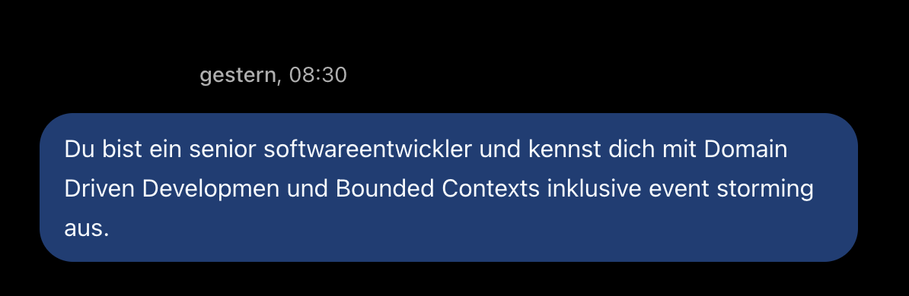
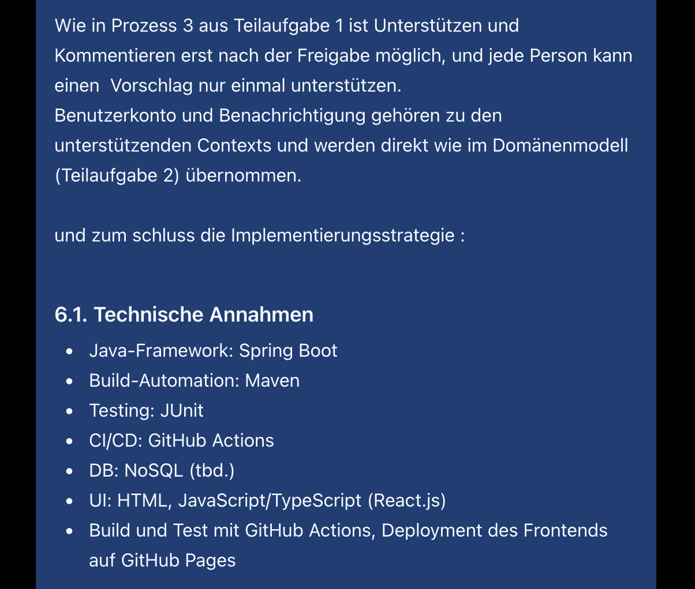
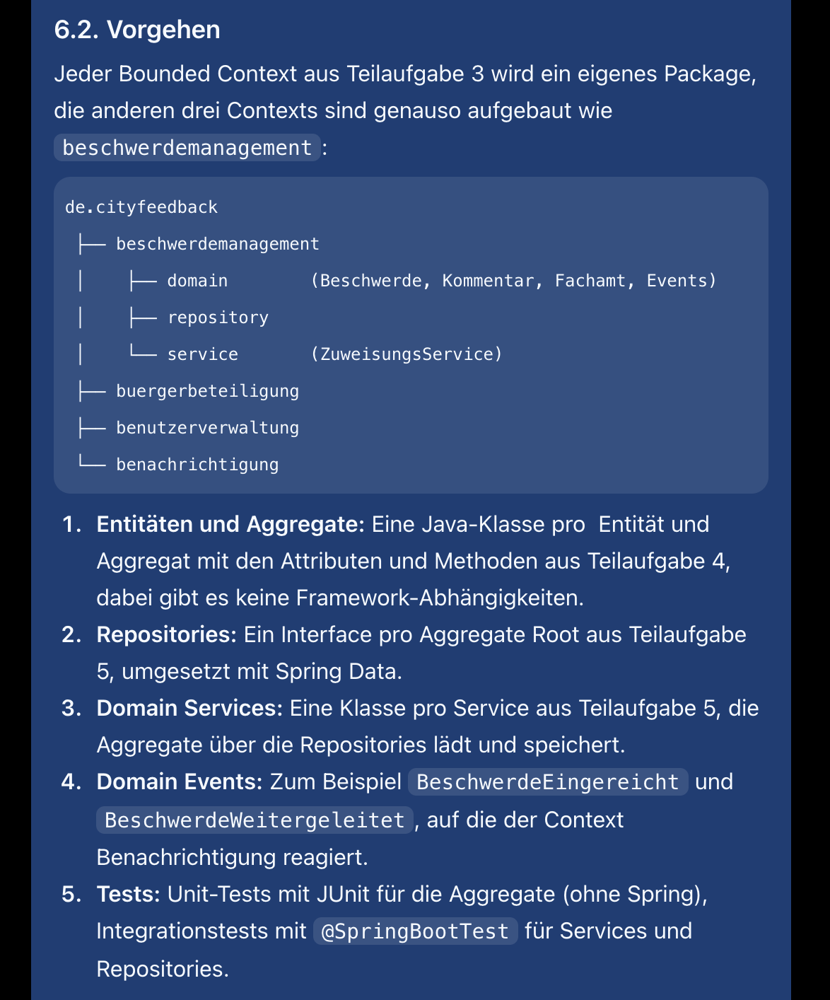
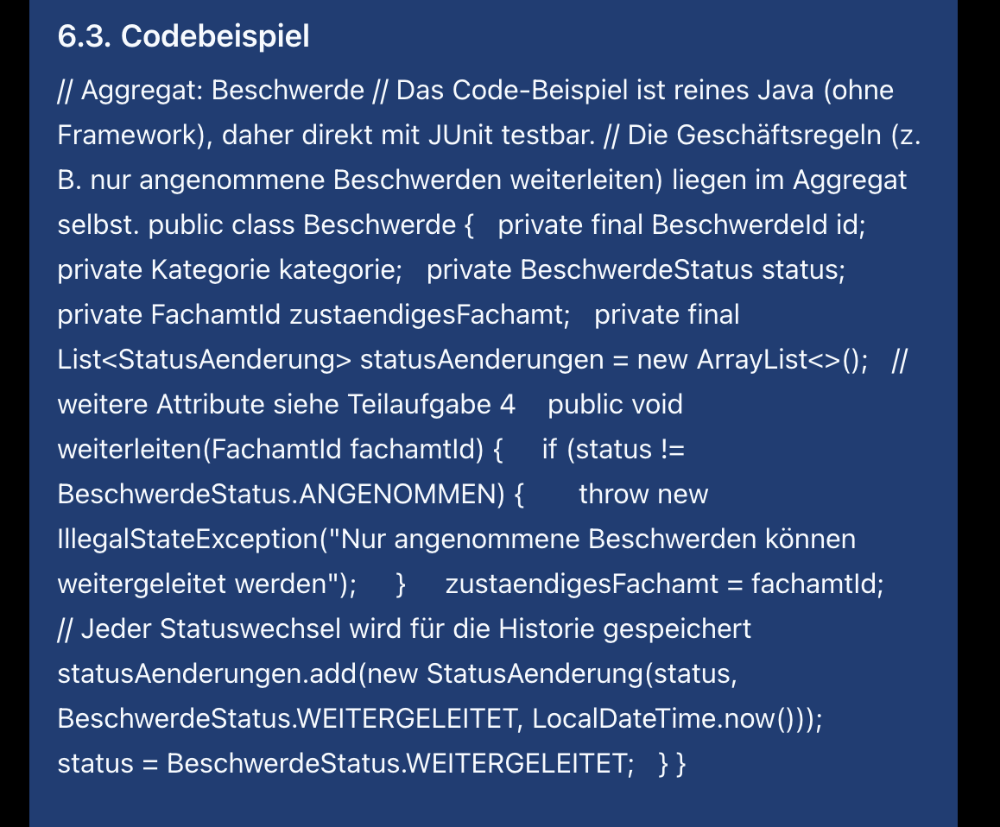
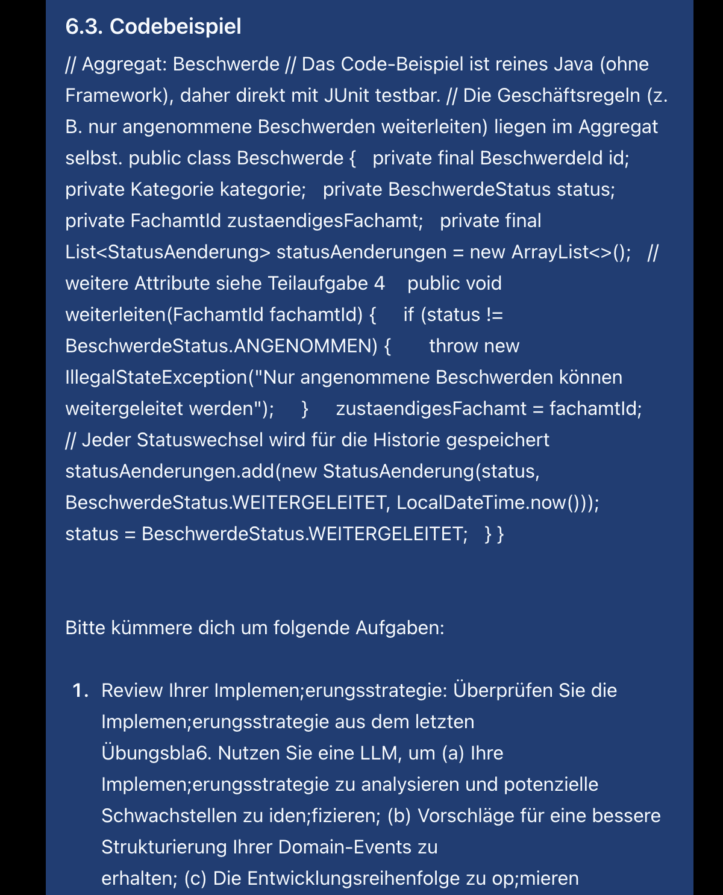
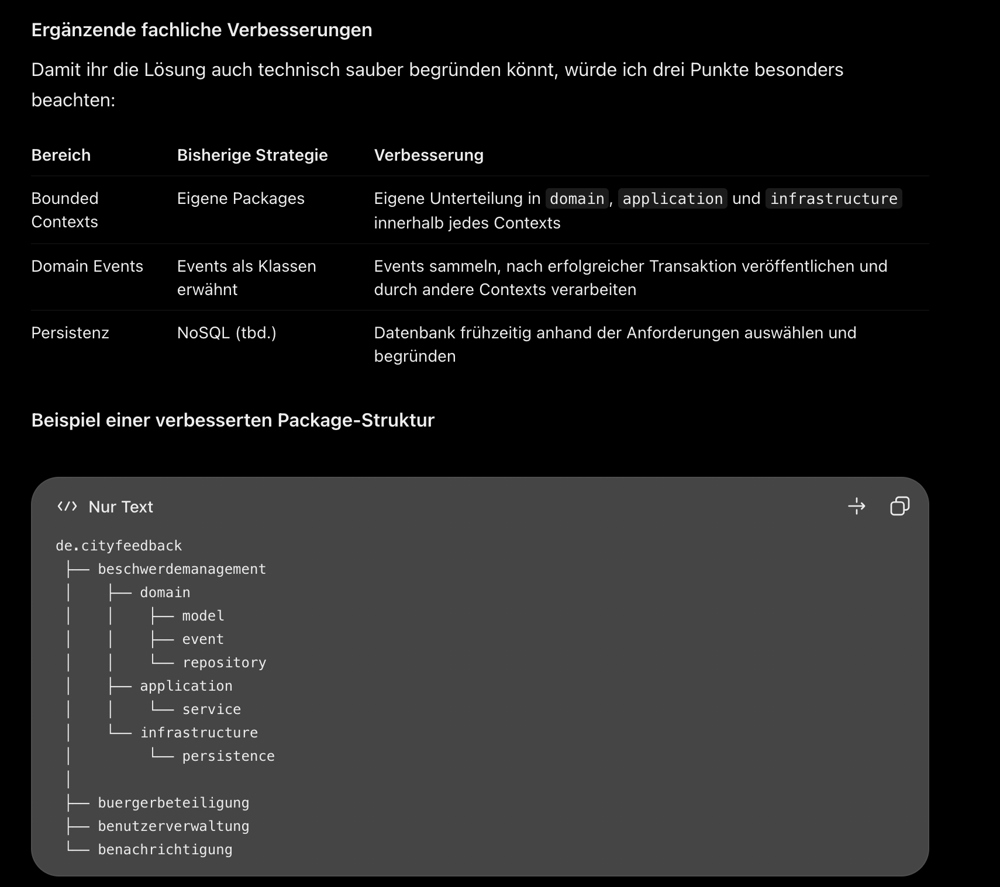
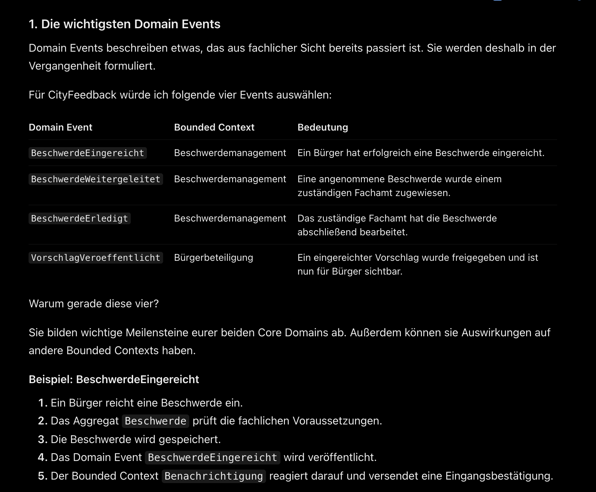
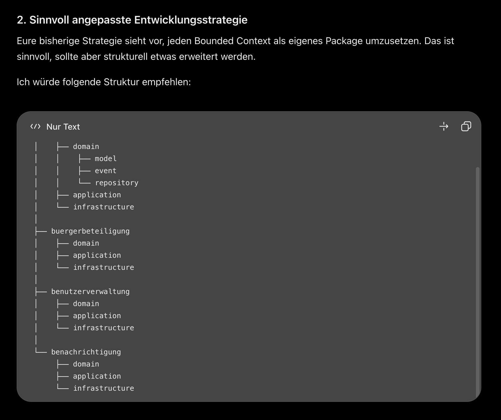
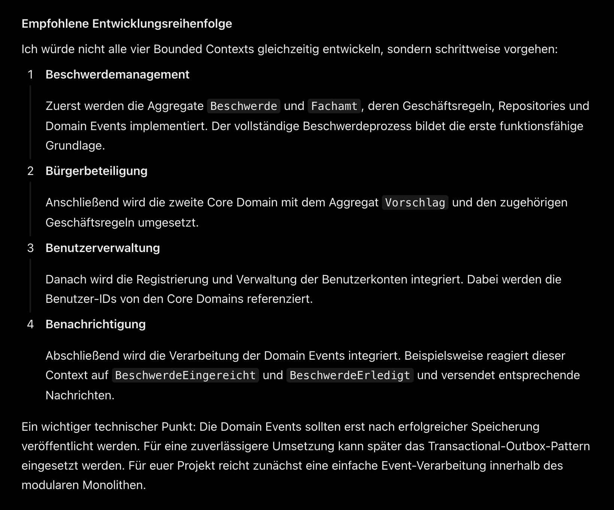

Übung 4

# 1. Review der Implementierungsstrategie
Als wichtigste Domain Events unseres Projekts wurden BeschwerdeEingereicht, BeschwerdeWeitergeleitet, BeschwerdeErledigt und VorschlagEingereicht identifiziert, da sie zentrale Geschäftsprozesse der beiden Core Domains abbilden. Übernommen wurde der LLM-Vorschlag, die Bounded Contexts zusätzlich in domain, application und infrastructure zu unterteilen, um fachliche Logik und technische Implementierung klar voneinander zu trennen. Ebenfalls übernommen wurde die Empfehlung, Domain Events erst nach erfolgreicher Speicherung zu veröffentlichen, damit es keine Eingangsbestätigung für eine Beschwerde geben kann, die nicht gespeichert wurde. Die Entwicklungsreihenfolge wurde dahingehend angepasst, dass zunächst die beiden Core Domains Beschwerdemanagement und Bürgerbeteiligung und anschließend die unterstützenden Contexts Benutzerverwaltung und Benachrichtigung implementiert werden. Abgelehnt wurde die Empfehlung, dass eine einfache Eventverarbeitung mit Spring Boot für den aktuellen Projektumfang ausreichend ist da es eine geringere technische Komplexität mit sich bringt, da die Planung für dieses Projekt von der Realität ausgeht.

Ausgewählte Domain-Events :
    - BeschwerdeEingereicht
    - BeschwerdeWeitergeleitet
    - BeschwerdeAbgeschlossen

Prompt: 

# 2. Tesfälle mit LLM generieren und validieren

## LLM Prompt

Der LLM wurde eine Rolle als erfahrerner Senior Softwareentwickler mit Java UnitTests nach dem TestDrivenDesign gegeben und im anschluss mit der Beschreibung der Domainlogik undinklusiver Domainevents gefüttert. 

## Generierte Tests

Happy Path:
    - beschwerdeErstellen()
    - sollteBeschwerdeAnFachamtWeiterleiten()
    - sollteBeschwerdeNurAnZustaendigesFachamtWeiterleiten()
    - beschwerdeAbschliessen()

Negativ Path:    
    - sollteNichtAngenommeneBeschwerdeNichtWeiterleiten()
    - beschwerdeOhneBearbeitungsbeginnNichtAbschliessen()

Edge-Case Path
    - sollteWiederholteStatusaenderungVerhindern()

## Kritische Bewertung

Beschwerde abgedeckt haben. Besonders hilfreich waren die Happy-Path-Tests, da sie den regulären Lebenszyklus einer Beschwerde nachvollziehbar überprüfen. Die Negative Tests wurden ebenfalls übernommen, um sicherzustellen, dass unzulässige Statusübergänge, beispielsweise die Weiterleitung einer abgelehnten Beschwerde, verhindert werden. Insbesondere dem Testfall beschwerdeErstellen() wurde erst auf konkrete Anfrage der LLM eine Regex-Validierung hinzugefügt. Einige Tests mussten angepasst werden,weil die namensgebung  nicht ideal war. Zusätzlich wurden Edge-Case-Tests ergänzt, um beispielsweise wiederholte Statusänderungen und ungültige Eingaben zu überprüfen. 

## Regex-Validierung

Bei der Regex-validierung wurde folgende Regel verwendet um sicher zu gehen, dass die Beschreibung Text enthält.

     // Regex-Validierung
    String regex = "^(?=.*\\S).{10,}$";

# 3. Implementierung der Domänenlogik (TDD Schritt 2) mit LLM-Pair-Programming

## 3.1 LLM Prompt

Das LLM bekam die Rolle eines Senior Java-Entwicklers als Pair-Programming-Partner, dazu die Beschreibung des Statusablaufs einer Beschwerde, die gewünschte Package-Struktur und alle acht Testdateien aus Aufgabe 2.
Für den ersten Schritt wurde bewusst die minimale Implementierung ohne fortgeschrittene Java-Techniken verlangt, damit die LLM nicht schon in diesem Schritt komplexeren Code generiert.
Da die Tests an einigen Stellen widersprüchliche Erwartungen haben, sollte das LLM diese zuerst auflisten und Lösungen vorschlagen, aber nicht selbst entscheiden.

Der vollständige Prompt liegt unter [llm-prompts/aufg-4-3-1-prompt.md](llm-prompts/aufg-4-3-1-prompt.md).

### Verbesserungen
- Zwei Tests nutzten verkürzte Signaturen ohne Beschreibung bzw. ohne Fachamt-Name 
- Die Tests wurden auf die vollständige Signatur vereinheitlicht, weil eine Beschwerde ohne Beschreibung und ein Fachamt ohne Namen fachlich keinen Sinn ergeben 
- Dadurch kommt die Implementierung mit je einer Methode bzw. einem Konstruktor aus
- `getStatusHistorie()` liefert eine Liste von `StatusHistorie`-Objekten statt nur Status, damit später Zeitstempel oder Bearbeiter ergänzt werden können
- Ungültige Statusübergänge werfen eine eigene `UngueltigerBeschwerdeStatusException`, die von `IllegalStateException` erbt, so bleiben alle Tests unverändert gültig
- Zwei Testklassen wurden umbenannt, damit Klassen- und Dateiname übereinstimmen und kein "ß" im Dateinamen steht
- Die Test-Helfer `neueBeschwerde()` und `zustaendigesFachamt()` liegen in einer gemeinsamen Klasse `BeschwerdeTestFixtures` statt in jedem Test einzeln

## Code-Generierung

## Iterative Verbesserung

## Kritische Qualitätsprüfung

## Code-Review mit LLM

## Dokumentation des Pair-Programming-Prozesses

