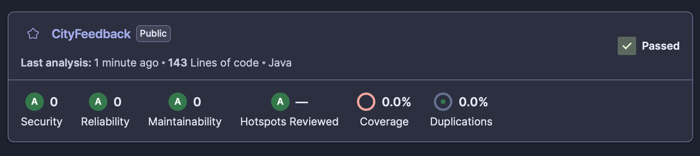
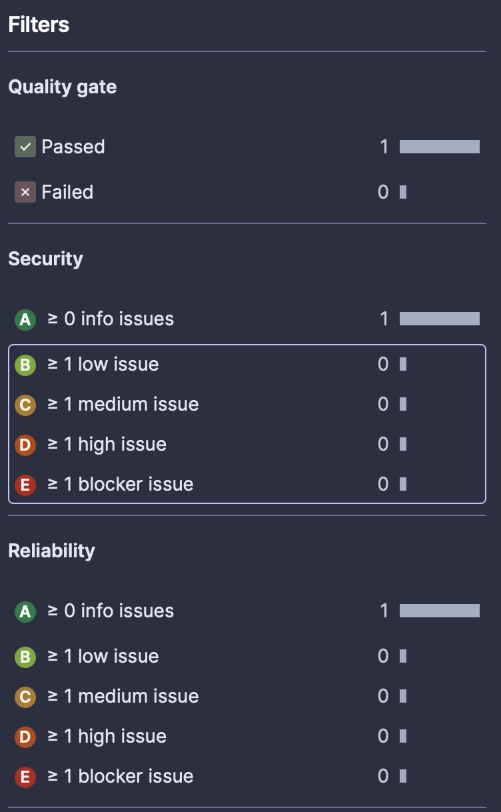
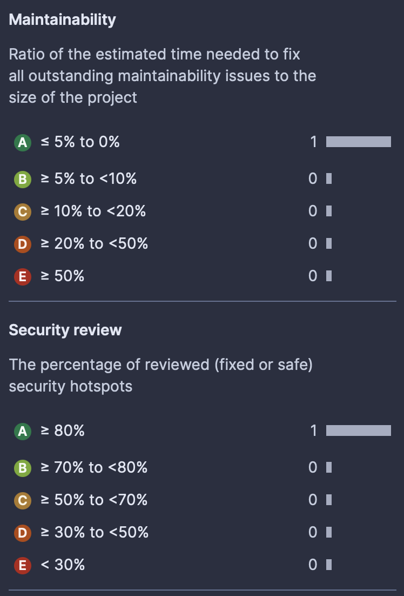
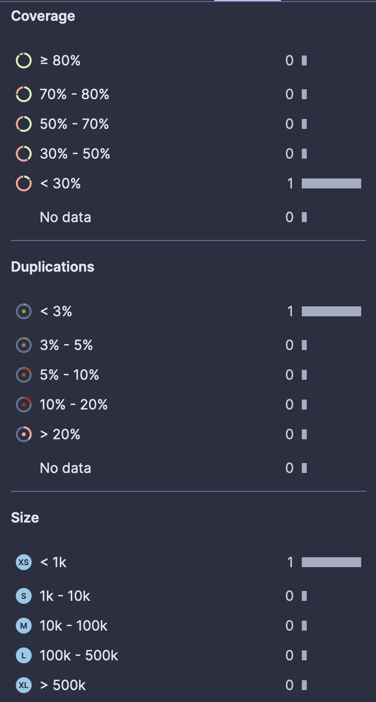

# Übung 5: Architekturoptimierung
## 1. Metriken
### Analyse ohne PlugIn
Zunächst haben wir ohne die Verwendung zusätzlicher PlugIns eigenständig eine Analyse des Projekts durchgeführt und die Anzahl der Packages, Klassen, Methoden/Konstruktoren und Parameter untersucht. 

#### main:

| Package / Klasse | Typ | Konstruktoren | Methoden | Parameter |
|---|---|---|---|---|
| **`de.cityfeedback`** | **Package** | - | - | -|
| **`de.cityfeedback.beschwerdemanagement.domain`** | **Package** | - | - | -|
| **`de.cityfeedback.beschwerdemanagement.domain.exception`** | **Package** | - | - | -|
| ↳ UngueltigerBeschwerdeStatusException | Klasse | 1 | - | -|
| ↳ | | `UngueltigerBeschwerdeStatusException()`| | `message`  |
| **`de.cityfeedback.beschwerdemanagement.domain.model`** | **Package** | - | - | -|
| ↳ Beschwerde| Klasse | 1 | 12 | 7 |
| ↳ | | `Beschwerde()`| | `beschreibung`,`kategorie` |
| ↳ | | | `einreichen()` | `beschreibung`,`kategorie` |
| ↳ | | | `annehmen()` |  |
| ↳ | | | `ablehnen()` |  |
| ↳ | | | `weiterleiten()` | `fachamt` |
| ↳ | | | `bearbeitungBeginnen()` |  |
| ↳ | | | `abschliessen()` |  |
| ↳ | | | `getBeschreibung()` |  |
| ↳ | | | `getKategorie()` |  |
| ↳ | | | `getStatus()` |  |
| ↳ | | | `getStatusHistorie()` |  |
| ↳ | | | `wechsleStatus()` | `neu`  |
| ↳ | | | `pruefeUebergang()` | `neu`  |
| ↳ Fachamt| Record | 1 | - | -|
| ↳ | | `Fachamt()`| | `name`,`kategorie` |
| **`de.cityfeedback.beschwerdemanagement.domain.valueObjects`** | **Package** | - | - | -|
| ↳ BeschwerdeStatus| Enum | - | -| - |
| ↳ Kategorie| Enum | - | -| - |
| ↳ StatusHistorie| Record| 1 | -| 1 |
| ↳ | | `StatusHistorie()`| | `Status` |
| ↳ Kategorie| Klasse| 1 | 3| 6 |
| ↳ | | `Kategorie()`| | `typ` |
| ↳ | | | `fuer()`| `typ` |
| ↳ | | | `erlaube()`| `von`,`nach` |
| ↳ | | | `istErlaubt()`| `von`,`nach` |

#### test:

| Package / Klasse | Typ | Konstruktoren | Methoden | Parameter |
|---|---|---|---|---|
| **`de.cityfeedback`** | **Package** | - | - | -|
| **`de.cityfeedback.beschwerdemanagement.domain`** | **Package** | - | - | -|
| **`de.cityfeedback.beschwerdemanagement.domain.event`** | **Package** | - | - | -|
| ↳ BearbeitungBegonnenTest | Klasse | - | 1 | -|
| ↳ | | | `bearbeitungBeginnen()` |  |
| ↳ BearbeitungAbgelehntTest | Klasse | - | 1 | -|
| ↳ | | | `abgelehnteBeschwerdeNichtWeiterleiten()` |  |
| ↳ BeschwerdeAbschliessenTest | Klasse | - | 2 | -|
| ↳ | | | `beschwerdeAbschliessen()` |  |
| ↳ | | | `beschwerdeOhneBearbeitungsbeginnNichtAbschliessen()` |  |
| ↳ BeschwerdeAnnehmenTest | Klasse | - | 1 | -|
| ↳ | | | `beschwerdeAnnehmen()` |  |
| ↳ BeschwerdeEinreichenTest | Klasse | - | 1 | -|
| ↳ | | | `beschwerdeErstellen()` |  |
| ↳ BeschwerdeprozessTest | Klasse | - | 1 | -|
| ↳ | | | `vollstaendigenBeschwerdeprozessDurchlaufen()` |  |
| ↳ BeschwerdeTestFixtures | Klasse | 1 | 2 | -|
| ↳ | | `BeschwerdeTestFixtures()` | | -|
| ↳ | | | `neueBeschwerde()` |  |
| ↳ | | | `zustaendigesFachamt()` |  |
| ↳ BeschwerdeWeiterleitenTest | Klasse | - | 4 | -|
| ↳ | | | `sollteBeschwerdeAnFachamtWeiterleiten()` |  |
| ↳ | | | `sollteNichtAngenommeneBeschwerdeNichtWeiterleiten()` |  |
| ↳ | | | `sollteBeschwerdeNurAnZustaendigesFachamtWeiterleiten()` |  |
| ↳ | | | `bearbeitungVorWeiterleitungVerhindern()` |  |
| **`de.cityfeedback.beschwerdemanagement.domain.valueObjects`** | **Package** | - | - | -|
| ↳ StatusAenderungTest| Klasse | - | 2 | -|
| ↳ | | | `sollteWiederholteStatusaenderungVerhindern()` |  |
| ↳ | | | `sollteStatushistorieAktualisieren()` |  |

Bei der Untersuchung der Methodenanzahl und Parameteranzahl konnten keine auffälligen Methoden festgestellt werden. Die Methoden besitzen überwiegend wenige Parameter und sind übersichtlich aufgebaut. Bei der Betrachtung der Code-Struktur konnten keine besonders komplexen oder stark verschachtelten Methoden identifiziert werden.

### Auswertung durch PlugIn
Für die Untersuchung der Codequalität wurde das IntelliJ-PlugIn "MetricsReloaded" verwendet. Es wurde das Profil "Complexity" eingesetzt. Ergänzend wurde für die Analyse SonarQube angewendet.

CogC (Cognitive Complexity): Verständlichkeit der Methode
ev(G) (Essential Complexity): Komplexität der Kontrollstruktur einer Methode
iv(G) (Design Complexity): Komplexität der Programmstruktur und ihrer Abhängigkeiten.
v(G) (Cyclomatic Complexity): Anzahl unabhängiger Ausführungspfade einer Methode.

| method  |	CogC | ev(G) |	iv(G) |	v(G) |
|---|---|---|---|---|
| de.cityfeedback.beschwerdemanagement.domain.event.BearbeitungBegonnenTest.bearbeitungBeginnen() | 0.0 | 1.0 | 1.0 | 1.0 |
| de.cityfeedback.beschwerdemanagement.domain.event.BeschwerdeAbgelehntTest.abgelehnteBeschwerdeNichtWeiterleiten() | 0.0 | 1.0| 1.0|	1.0|
| de.cityfeedback.beschwerdemanagement.domain.event.BeschwerdeAbschliessenTest.beschwerdeAbschliessen()	| 0.0| 1.0	| 1.0	| 1.0|
| de.cityfeedback.beschwerdemanagement.domain.event.BeschwerdeAbschliessenTest.beschwerdeOhneBearbeitungsbeginnNichtAbschliessen()	| 0.0	| 1.0	 | 1.0	| 1.0|
| de.cityfeedback.beschwerdemanagement.domain.event.BeschwerdeAnnehmenTest.beschwerdeAnnehmen()	| 0.0	| 1.0	| 1.0	| 1.0|
| de.cityfeedback.beschwerdemanagement.domain.event.BeschwerdeEinreichenTest.beschwerdeErstellen()	| 0.0	| 1.0	| 1.0	| 1.0|
| de.cityfeedback.beschwerdemanagement.domain.event.BeschwerdeprozessTest.vollstaendigenBeschwerdeprozessDurchlaufen()	| 0.0	| 1.0	| 1.0	| 1.0|
| de.cityfeedback.beschwerdemanagement.domain.event.BeschwerdeTestFixtures.BeschwerdeTestFixtures()	| 0.0	| 1.0	| 1.0	| 1.0|
| de.cityfeedback.beschwerdemanagement.domain.event.BeschwerdeTestFixtures.neueBeschwerde()	| 0.0	| 1.0	| 1.0	| 1.0|
| de.cityfeedback.beschwerdemanagement.domain.event.BeschwerdeTestFixtures.zustaendigesFachamt()	| 0.0	| 1.0	| 1.0	| 1.0|
| de.cityfeedback.beschwerdemanagement.domain.event.BeschwerdeWeiterleitenTest.bearbeitungVorWeiterleitungVerhindern()	| 0.0	| 1.0	| 1.0	| 1.0|
| de.cityfeedback.beschwerdemanagement.domain.event.BeschwerdeWeiterleitenTest.sollteBeschwerdeAnFachamtWeiterleiten()	| 0.0	| 1.0	| 1.0	| 1.0|
| de.cityfeedback.beschwerdemanagement.domain.event.BeschwerdeWeiterleitenTest.sollteBeschwerdeNurAnZustaendigesFachamtWeiterleiten()	| 0.0	| 1.0	| 1.0	| 1.0|
| de.cityfeedback.beschwerdemanagement.domain.event.BeschwerdeWeiterleitenTest.sollteNichtAngenommeneBeschwerdeNichtWeiterleiten()	| 0.0	| 1.0	| 1.0	| 1.0|
| de.cityfeedback.beschwerdemanagement.domain.exception.UngueltigerBeschwerdeStatusException.UngueltigerBeschwerdeStatusException(String)	| 0.0	| 1.0	| 1.0	| 1.0|
| de.cityfeedback.beschwerdemanagement.domain.model.Beschwerde.ablehnen()	| 0.0	| 1.0	| 1.0	| 1.0|
| de.cityfeedback.beschwerdemanagement.domain.model.Beschwerde.abschliessen()	| 0.0	| 1.0	| 1.0	| 1.0|
| de.cityfeedback.beschwerdemanagement.domain.model.Beschwerde.annehmen()	| 0.0	| 1.0	| 1.0	| 1.0|
| de.cityfeedback.beschwerdemanagement.domain.model.Beschwerde.bearbeitungBeginnen()	| 0.0	| 1.0	| 1.0	| 1.0|
| de.cityfeedback.beschwerdemanagement.domain.model.Beschwerde.Beschwerde(String, Kategorie)	| 0.0	| 1.0	| 1.0	| 1.0|
| de.cityfeedback.beschwerdemanagement.domain.model.Beschwerde.einreichen(String, Kategorie)	| 0.0	| 1.0	| 1.0	| 1.0|
| de.cityfeedback.beschwerdemanagement.domain.model.Beschwerde.getBeschreibung()	| 0.0	| 1.0	| 1.0	| 1.0|
| de.cityfeedback.beschwerdemanagement.domain.model.Beschwerde.getKategorie()	| 0.0	| 1.0	| 1.0	| 1.0|
| de.cityfeedback.beschwerdemanagement.domain.model.Beschwerde.getStatus()	| 0.0	| 1.0	| 1.0	| 1.0|
| de.cityfeedback.beschwerdemanagement.domain.model.Beschwerde.getStatusHistorie()	| 0.0	| 1.0	| 1.0	| 1.0|
| de.cityfeedback.beschwerdemanagement.domain.model.Beschwerde.pruefeUebergang(BeschwerdeStatus)	| 1.0	| 2.0	| 1.0	| 2.0|
| de.cityfeedback.beschwerdemanagement.domain.model.Beschwerde.wechsleStatus(BeschwerdeStatus)	| 0.0	| 1.0	| 1.0	| 1.0|
| de.cityfeedback.beschwerdemanagement.domain.model.Beschwerde.weiterleiten(Fachamt)	| 1.0	| 2.0	| 2.0	| 2.0|
| de.cityfeedback.beschwerdemanagement.domain.valueObjects.StatusAenderungTest.sollteStatushistorieAktualisieren()	| 0.0	| 1.0	| 1.0	| 1.0|
| de.cityfeedback.beschwerdemanagement.domain.valueObjects.StatusAenderungTest.sollteWiederholteStatusaenderungVerhindern()	| 0.0	| 1.0	| 1.0	| 1.0|
| de.cityfeedback.beschwerdemanagement.domain.valueObjects.Uebergangsregeln.erlaube(S, S...)	| 0.0	| 1.0	| 1.0	| 1.0|
| de.cityfeedback.beschwerdemanagement.domain.valueObjects.Uebergangsregeln.fuer(Class)	| 0.0	| 1.0	| 1.0	| 1.0|
| de.cityfeedback.beschwerdemanagement.domain.valueObjects.Uebergangsregeln.istErlaubt(S, S)	| 1.0	| 1.0	| 2.0	| 2.0|
| de.cityfeedback.beschwerdemanagement.domain.valueObjects.Uebergangsregeln.Uebergangsregeln(Class)	| 0.0	| 1.0	| 1.0	| 1.0|
| de.cityfeedback.CityFeedbackApplication.main(String[])	| 0.0	| 1.0	| 1.0	| 1.0|
| de.cityfeedback.CityFeedbackApplicationTest.contextLoadsWithH2Database()	| 0.0	| 1.0	| 1.0	| 1.0|
| Total	| 3.0	| 38.0	| 38.0	| 39.0|
| Average	| 0.08	| 1.06	| 1.06	| 1.08|

Diese Tabelle zeigt die Komplexität der einzelnen Methoden. Insgesamt weist CityFeedback eine sehr geringe zyklomatische Komplexität (v(G)) auf. Die Werte liegen bei den Methoden zum Großteil bei „1“. Drei Methoden weisen den Wert „2“ auf.
Die CogC ist nicht höher als „1“, was auf eine sehr gute Verständlichkeit der Methoden hinweist. Bis auf zwei Methoden zeigt der ev(G) den Wert „1“. Die Methoden besitzen eine gut strukturierte Kontrollstruktur. Die Designkomplexität ist ebenfalls gering und zeigt eine gute Programmstruktur.

Es fallen drei Methoden besonders auf:
In Klasse "Beschwerde": `pruefeUebergang()` mit einem ev(G) und v(G) von „2“.
In Klasse "Beschwerde": `weiterleiten()` weist bis auf CogC den Wert „2“ auf.
In Klasse "Uebergangsregeln": `istErlaubt()` mit einem iv(G) und v(G) von „2“.

Diese Methoden sind nicht problematisch. Nach genauer Betrachtung der Methoden, wird erkennbar, dass die zwei Methoden in der Klasse „Beschwerde“ eine if-Abfrage beinhalten. Die erhöhte Komplexität bei der Methode „istErlaubt()“ entsteht durch die Verwendung des UND-Operators. Dadurch ergeben sich zwei mögliche Ausführungspfade. Eine Optimierung der drei Methoden ist nicht notwendig, da die Implementierung bereits kompakt und gut verständlich ist.

Die durchschnittlichen Werte sind insgesamt sehr niedrig und deuten auf übersichtliche Methoden mit wenigen Verzweigungen und einer geringen strukturellen Komplexität hin.

Die zwei Record-Klassen „Fachamt“ und „StatusHistorie“ wurden bei der Metriktabelle nicht erfasst, wodurch die jeweiligen automatisch generierten Konstruktoren nicht berücksichtigt werden. 


Die folgende Tabelle zeigt die Komplexität der einzelnen Klassen.

OCavg (Average Operation Complexity): Durchschnittliche Komplexität der Methoden einer Klasse
OCmax (Maximum Operation Complexity): Maximale Methodenkomplexität innerhalb der Klasse
WMC (Weighted Methods per Class): Summe der Komplexitätswerte aller Methoden einer Klasse 

| class  |	OCavg | OCmax |	WMC |
|---|---|---|---|
| de.cityfeedback.beschwerdemanagement.domain.model.Beschwerde	| 1.15 | 2.0| 15.0 | 
| de.cityfeedback.CityFeedbackApplication	| 1.0 | 1.0	| 1.0 |
| de.cityfeedback.CityFeedbackApplicationTest	| 1.0	| 1.0	| 1.0|
| de.cityfeedback.beschwerdemanagement.domain.event.BearbeitungBegonnenTest	| 1.0 | 1.0	| 1.0|
| de.cityfeedback.beschwerdemanagement.domain.event.BeschwerdeAbgelehntTest	| 1.0	| 1.0	| 1.0|
| de.cityfeedback.beschwerdemanagement.domain.event.BeschwerdeAbschliessenTest	| 1.0	| 1.0	| 2.0|
| de.cityfeedback.beschwerdemanagement.domain.event.BeschwerdeAnnehmenTest	| 1.0	| 1.0	| 1.0|
| de.cityfeedback.beschwerdemanagement.domain.event.BeschwerdeEinreichenTest	| 1.0	| 1.0	| 1.0|
| de.cityfeedback.beschwerdemanagement.domain.event.BeschwerdeTestFixtures	| 1.0	| 1.0	| 3.0|
| de.cityfeedback.beschwerdemanagement.domain.event.BeschwerdeWeiterleitenTest	| 1.0	| 1.0	| 4.0|
| de.cityfeedback.beschwerdemanagement.domain.event.BeschwerdeprozessTest	| 1.0	| 1.0	| 1.0|
| de.cityfeedback.beschwerdemanagement.domain.exception.UngueltigerBeschwerdeStatusException	| 1.0	| 1.0	| 1.0|
| de.cityfeedback.beschwerdemanagement.domain.valueObjects.StatusAenderungTest	| 1.0	| 1.0	| 2.0|
| de.cityfeedback.beschwerdemanagement.domain.valueObjects.Uebergangsregeln	| 1.0	| 1.0	| 4.0|
| de.cityfeedback.beschwerdemanagement.domain.model.Fachamt			| | | 0.0|
| de.cityfeedback.beschwerdemanagement.domain.valueObjects.BeschwerdeStatus			| | | 0.0|
| de.cityfeedback.beschwerdemanagement.domain.valueObjects.Kategorie			| | | 0.0|
| de.cityfeedback.beschwerdemanagement.domain.valueObjects.StatusHistorie			| | | 0.0|
| Total			| | | 38.0|
| Average	| 1.06	| 1.07	| 2.11|

Alle Klassen weisen eine geringe durchschnittliche Methodenkomplexität. Bis auf die Klasse „Beschwerde“ liegt die maximale Methodenkomplexität bei dem Wert „1“. Die WMC-Werte der einzelnen Klassen sind ebenfalls sehr gering. Auffällig ist die Klasse „Beschwerde“, die mit dem WMC-Wert von „15“ deutlich über den anderen Klassen liegt.
Diese Klasse enthält die meisten Methoden und kann genauer untersucht werden.
Allerdings liegt die durchschnittliche Methodenkomplexität bei bei etwa 1,15. Die maximale Komplexität beträgt ebenfalls nur „2“. Diese Werte zeigen, dass die Klasse „Beschwerde“ zwar mehrere Methoden enthält, diese jedoch überwiegend einfach aufgebaut sind.

Weitere auffällige Klassen, die nur laut dem WMC-Wert genauer betrachtet werden können:

BeschwerdeWeiterleitenTest				WMC:4
Uebergangsregeln						WMC:4
BeschwerdeTestFixtures					WMC:3
StatusAenderungTest					    WMC:2
BeschwerdeAbschliessenTest				WMC:2

Die enum-Klassen „BeschwerdeStatus“ und „Kategorie“ sowie die beiden record-Klassen „Fachamt“ und „StatusHistorie“ wurden in dieser Tabelle nicht berücksichtigt und zeigen den Wert „0“.


Diese Tabelle zeigt die durchschnittliche und gesamte zyklomatische Komplexität der einzelnen Packages. 

v(G)avg: Durchschnittliche zyklomatische Komplexität der Methoden im Package
v(G)tot: Summe der zyklomatischen Komplexität aller Methoden im Package

| package  |	v(G)avg | v(G)tot |
|---|---|---|
| de.cityfeedback	| 1.0	| 2.0|
| de.cityfeedback.beschwerdemanagement.domain.event	| 1.0	| 14.0|
| de.cityfeedback.beschwerdemanagement.domain.exception	| 1.0	| 1.0|
| de.cityfeedback.beschwerdemanagement.domain.model	| 1.15	| 15.0|
| de.cityfeedback.beschwerdemanagement.domain.valueObjects	| 1.17	| 7.0|
| Total		|| 39.0|
| Average	| 1.08	| 7.8|

Das Package „valueObjects“ existiert sowohl in „main“ als auch in „test“ und wurde zusammengefasst. Ebenso das Package „de.cityfeedback“ wurde hier zusammengefasst.
Das Package „beschwerdemanagement.domain“ wird hier nicht berücksichtigt, da sie selber keine Java-Klasse beinhaltet, sondern lediglich die verschiedenen Unterpackages.
Die durchschnittliche zyklomatische Komplexität ist in jedem Packages sehr gering und zeigt, dass die Methoden sehr einfach gebaut sind. Die v(G)tot-Werte zeigen jedoch auffällige Packages, die genauer betrachtet werden können:

de.cityfeedback.beschwerdemangement.domain.model
de.cityfeedback.beschwerdemangement.domain.event
de.cityfeedback.beschwerdemangement.domain.valueObject

Diese Packages weisen eine höhere zyklomatische Komplexität, welches auf mehrere unabhängige Ausführungspfade hinweisen kann. Besonders auffällig sind die Packages „model“ mit dem Wert „15“ und event“ mit dem Wert „14“. Bei dem Package „model“ ist vor allem wieder auf die Klasse „Beschwerde“ zurückzuführen, die die meisten Methoden besitzt. Das Package „event“ hat mehrere Klassen mit insgesamt viele Methoden und weist daher einen höheren Wert auf. Das Package „valueObject“ hat den höchsten v(G)avg-Wert. Da das Package „valueObjects“ zusammengefasst wurde, sollte für die Packages eine getrennte Analyse der Anwendungslogik und Testimplementierung durchgeführt werden. 

Auswertung von Package „valueObject“ in „test“:

| package  |	v(G)avg | v(G)tot |
|---|---|---|
| de.cityfeedback.beschwerdemanagement.domain.valueObjects	| 1.0	| 2.0 |


Der Testcode weist eine geringere Gesamtkomplexität auf. Die Testmethoden sind einfach aufgebaut und enthalten wenige Verzweigungen.
Für die Anwendungslogik ergibt sich dadurch der Wert „5“ für die v(G)tot.
Insgesamt zeigt die Analyse eine gleichmäßige Verteilung der Komplexität. 


Diese Tabelle veranschaulicht die zyklomatische Komplexität des gesamten Projekts auf Modulebene. Hier kann der Anwendungscode (main) mit dem Testcode (test) verglichen werden. 

| module | v(G)avg | v(G)tot |
|---|---|---|
| CityFeedback.main	| 1.16	| 22.0|
| CityFeedback.test	| 1.0	| 17.0|
|Total		||39.0|
|Average	| 1.08	| 19.5|

Der Anwendungscode besitzt eine etwas höhere durchschnittliche Komplexität als der Testcode und deutet auf etwas mehr Verzweigungen und verschiedene Ausführungspfade hin. Der Testcode ist etwas übersichtlicher aufgebaut als der Anwendungscode. Zudem zeigt das Ergebnis, dass der Anwendungscode den größeren Anteil an der Gesamtkomplexität des Projekts ausmacht. 


Die folgende Tabelle zeigt die gesamte zyklomatische Komplexität des Projekts.

| project	| v(G)avg | v(G)tot |
|---|---|---|
| project	| 1.08	| 39.0|

Der Durchschnittswert „1,08“ zeigt, dass die meisten Methoden nur einen Ausführungspfad besitzen und nur wenige zusätzliche Verzweigungen vorhanden sind. Die Kontrollstrukturen sind überwiegend einfach gebaut und es gibt keine Anzeichen auf besonders komplexe Methoden.

Die bisherigen Ergebnisse zeigen wiederholend, dass die Klasse „Beschwerde aufgrund ihrer vergleichsweise hohen Gesamtkomplexität genauer untersucht werden kann. 

### Auswertung von SonarQube
Die Auswertung zeigt, das das Projekt bestimmte Qualitätsanforderungen erfüllt und wurde ingesamt mit „Passed“ bewertet. 






Interpretation:
Es gibt wenige Sicherheitsprobleme und die Security-Hotspots sollten zu mindestens 80% überprüft sein. Die Reliability zeigt, dass es möglichst keine Bugs gibt, die zu Fehlverhalten oder Abstürzen führen können. Die Maintainablity ist ebenfalls sehr gering. Der Wert bei Duplications liegt bei unter 3 % und spricht für ein wenig redundanten Code. Es handelt sich mit 143 Lines of Code außerdem um ein kleines Projekt unter 1000 Lines of Code. Die Testabdeckung des Codes beträgt weniger als 30 % und bedeutet, dass ein großer Teil des Codes nicht durch die automatisierten Test abgedeckt ist. Damit stellt die Testabdeckung eine Schwachstelle da, wo Verbesserungsbedarf besteht.

### LLM-Einsatz für mögliche Optimierung
Als Erstes fällt auf, dass die Klasse "Beschwerde" mehrere Aufgaben gleichzeitig übernimmt:
- Verwaltung der Beschwerdedaten. 
- Verwaltung des aktuellen Beschwerdestatus.
- Überprüfung der Zuständigkeit eines Fachamts.
- Statusänderungen.
- Prüfung der Statusübergänge.
- Speicherung der Statushistorie.

Die vorherige Methoden-Metrics zeigte zwei auffällige Methoden:
`weiterleiten()`: Enthält zwei Kontrollschritte.
`pruefeUebergang()`: Enthält eine einfache if-Abfrage.

In `weiterleiten()` wird geprüft, ob das übergebene Fachamt für die Kategorie der Beschwerde zuständig ist.

```bash
if (fachamt.kategorie() != kategorie) {
throw new IllegalArgumentException(
"Fachamt " + fachamt.name() + " ist nicht zustaendig fuer Kategorie " + kategorie);
}
```
Die Implementierung ist bereits kompakt.
Die Zuständigkeitsprüfung könnte optional in eine eigene private Methode ausgelagert werden.:

```bash
private void pruefeZustaendigkeit(Fachamt fachamt) {
    if (fachamt.kategorie() != kategorie) {
        throw new IllegalArgumentException(
            "Fachamt " + fachamt.name()
                + " ist nicht zustaendig fuer Kategorie " + kategorie);
    }
}
```
Dadurch wird die Methode `weiterleiten()` übersichtlicher:

```bash
public void weiterleiten(Fachamt fachamt) {
    pruefeUebergang(WEITERGELEITET);
    pruefeZustaendigkeit(fachamt);
    wechsleStatus(WEITERGELEITET);
}
```

Die Methode `pruefeUebergang()` verwendet die Klasse "Uebergangsregeln", um festzustellen, ob ein Statuswechsel erlaubt ist. 

```bash
private void pruefeUebergang(BeschwerdeStatus neu) {
    if (!REGELN.istErlaubt(status, neu)) {
        throw new UngueltigerBeschwerdeStatusException(
            "Uebergang nach " + neu + " ist aus Status " + status + " nicht erlaubt");
    }
}
```
Die Methode ist ebenfalls bereits gut strukturiert, daher ist eine Optimierung hier eher unnötig. 

Die Klasse "Beschwerde" weist zwar einen höheren WMC-Wert auf, allerdings besitzen die einzelnen Methoden nur eine geringe Komplexität. Die maximale zyklomatische Komplexität von "2" bestätigt, dass die Methoden nur wenige Verzweigungen enthalten. Insgesamt bestätigt die LLM-Analyse die bisherigen Ergebnisse der Metrikauswertung. 
