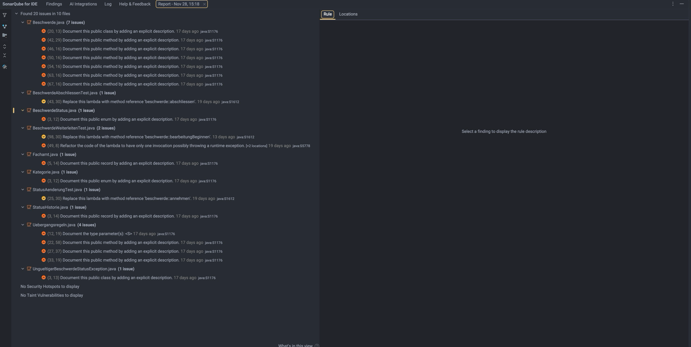

# 3. Technical Debt und Regelverletzungen mit LLM analysieren

**Ziel:** Technische Schuld und Regelverletzungen erfassen, nach Schweregrad einordnen und mit LLM-Unterstützung reduzieren

**Tools:** SonarQube (siehe Teil 1), SonarQube for IDE, OSV-Datenbank, _LLM_

## Phase 1: Analyse mit Tools und LLM

### 1.1 Ausgangslage aus Teil 1

Die SonarQube-Analyse aus Teil 1 dient als Basis und wird hier nicht wiederholt.
Ergebnis: 0 Issues in Security, Reliability und Maintainability, 0 % Duplizierung, Technical Debt nahe 0, Coverage unter 30 %.
Mit den Standardregeln ("Sonar way") findet SonarQube also keine technische Schuld, daher verschärfen wir die Regeln.

### 1.2 Erweiterte Regeln in SonarQube for IDE

Zusätzlich aktiviert: S109 (Magic Numbers), S2384 (Mutable Members), S1176 (Javadoc für öffentliche API).
S1176 prüft standardmäßig nur Packages unter `**.api.**`, daher wurde `forClasses` auf `beschwerdemanagement.**` gesetzt.

### 1.3 Ergebnisse der Tools

| Regel | Verletzung | Schweregrad | Anzahl | Ort |
|---|---|---|---|---|
| S1176 | "Document this public … by adding an explicit description" (keine Javadoc an öffentlicher API) | Mittel | 16 | `main`, 7 Dateien |
| S5778 | "Refactor the code of the lambda to have only one invocation possibly throwing a runtime exception" | Mittel | 1 | `test` |
| S1612 | "Replace this lambda with method reference" | Niedrig | 3 | `test` |
| **Gesamt** | | | **20** | **10 Dateien** |

Veraltete Abhängigkeiten (abgeglichen mit OSV-Datenbank und Maven Central):

| Abhängigkeit | Version | Aktuell | Befund |
|---|---|---|---|
| `assertj-core` | 3.27.3 | 3.27.7 | Sicherheitslücke CVE-2026-24400 (XXE) |
| Checkstyle | 10.21.0 | 14.4.0 | 4 Major-Versionen zurück |
| JUnit Jupiter | 5.12.2 | 6.1.3 | 1 Major-Version zurück |

### 1.4 Prompt an das LLM

### 1.5 Antwort des LLM

Vollständige Antwort: [llm-out/u5-3-antwort-2.md](llm-out/u5-3-antwort-2.md)

| Fund | Schweregrad laut LLM | Übernehmen? |
|---|---|---|
| AssertJ-CVE | niedrig (nur Test-Scope, `isXmlEqualTo` ungenutzt) | ja |
| JUnit 6, Checkstyle 14 | niedrig | ja, als eigene Schritte |
| S1176 Javadoc (16x) | niedrig | teilweise, nur `Beschwerde` und `Uebergangsregeln` |
| S5778, S1612 (4x, Tests) | niedrig | ja |

**Top 3:** AssertJ patchen, Test-Issues beheben, Updates und gezielte Javadoc.

**Anmerkung:** Das LLM ergänzt Angaben ohne Grundlage: "Tool: hoch" bei der CVE (kein Tool lieferte diesen Schweregrad) und "Scanner/CI bleiben rot" (die CI enthält keinen Scanner).

## Phase 2: Auswertung, Bewertung und Einordnung

| Problem | Kategorie | Schweregrad (SonarQube) | Schweregrad (LLM) | Bewertung |
|---|---|---|---|---|
| AssertJ 3.27.3 (CVE-2026-24400) | Abhängigkeit / Sicherheit | – (Fund via OSV / Maven Central, nicht SonarQube) | niedrig | übernehmen, Update auf 3.27.7 |
| JUnit 5.12.2, Checkstyle 10.21.0 | Abhängigkeit | – (Fund via OSV / Maven Central, nicht SonarQube) | niedrig | übernehmen, je ein eigener Schritt |
| S1176 fehlende Javadoc (16x) | Code Smell | mittel | niedrig | teilweise, nur `Beschwerde` und `Uebergangsregeln` dokumentieren |
| S5778 Lambda mit mehreren Aufrufen | Code Smell (Test) | mittel | niedrig | übernehmen |
| S1612 Lambda statt Methodenreferenz (3x) | Code Smell (Test) | niedrig | niedrig | übernehmen |

**Einordnung:** Kritische Schuld gibt es nicht, Duplizierung wurde nicht gefunden.
16 von 20 Funden sind fehlende Javadoc und damit eher formale Schuld, der einzige Sicherheitsfund ist im Projekt nicht ausnutzbar.
Das LLM hat die Tool-Schweregrade sinnvoll in den Projektkontext eingeordnet, aber auch Angaben ohne Grundlage ergänzt (siehe 1.5).

Die übernommenen Maßnahmen werden in der nächsten Iteration umgesetzt und danach erneut mit SonarQube for IDE geprüft.

## Reflexion

- **Was hat das LLM gut gemacht?** _TODO_
- **Wo waren Grenzen / Fehler?** _TODO_
- **Mehrwert für den Prozess:** _TODO_
