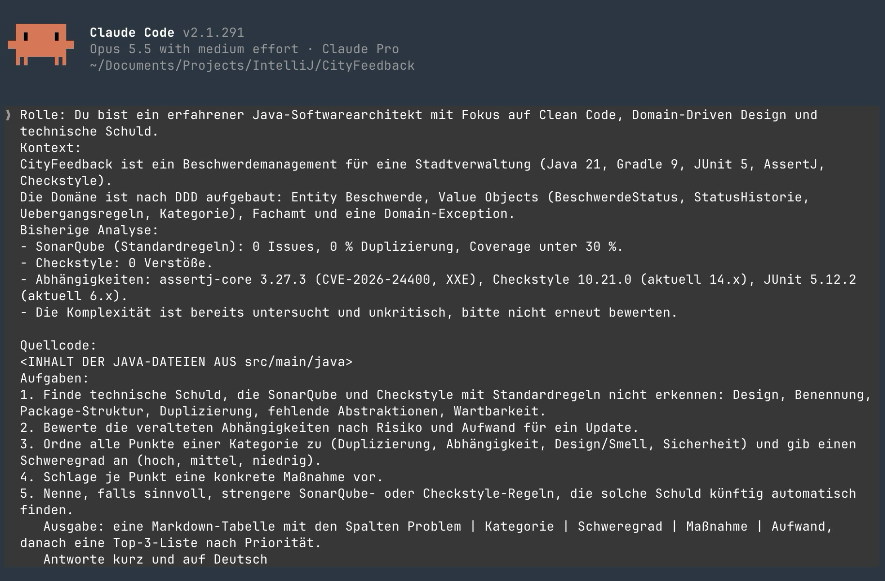

# 3. Technical Debt und Regelverletzungen mit LLM analysieren

**Ziel:** Technische Schuld mit SonarQube erfassen, nach Schweregrad einordnen und mit LLM-Unterstützung reduzieren.
**Tools:** SonarQube, _LLM_

## Phase 1: Analyse mit SonarQube und LLM

### 1.1 SonarQube-Analyse

| Metrik | Wert |
|---|---|
| Technical Debt | _TODO_ |
| Code Smells | _TODO_ |
| Bugs / Vulnerabilities | _TODO_ |
| Duplizierung | _TODO_ |

### 1.2 Prompt an das LLM

### 1.3 Antwort des LLM

## Phase 2: Auswertung, Bewertung und Einordnung

| Problem | Kategorie (Duplizierung / Abhängigkeit / Smell) | Schweregrad | LLM-Empfehlung | Bewertung (übernehmen / verwerfen) |
|---|---|---|---|---|
| _TODO_ | | | | |

**Einordnung:** _TODO, 2-3 Sätze: wo liegt die meiste Schuld, was ist kritisch, wo lag das LLM daneben._

## Phase 3: Optimierung und Reduktion (ongoing)

| # | Maßnahme | Status | Vorher → Nachher |
|---|---|---|---|
| 1 | _TODO_ | offen | |

## Reflexion

- **Was hat das LLM gut gemacht?** _TODO_
- **Wo waren Grenzen / Fehler?** _TODO_
- **Mehrwert für den Prozess:** _TODO_
