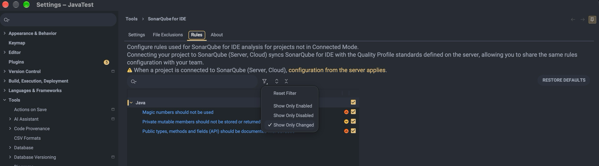
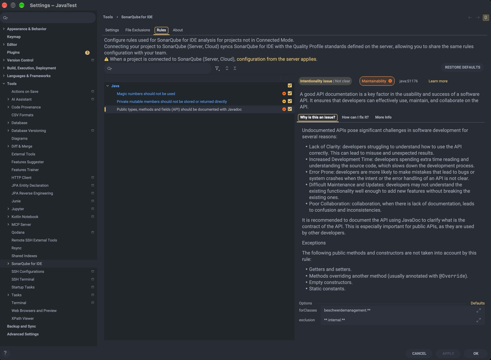
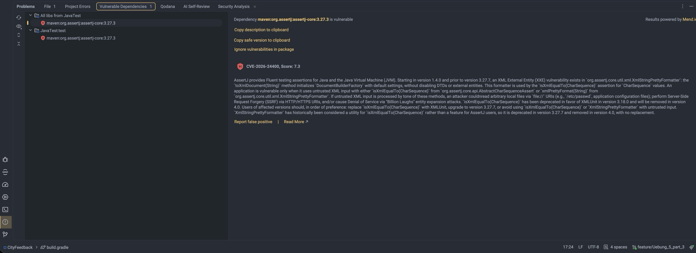
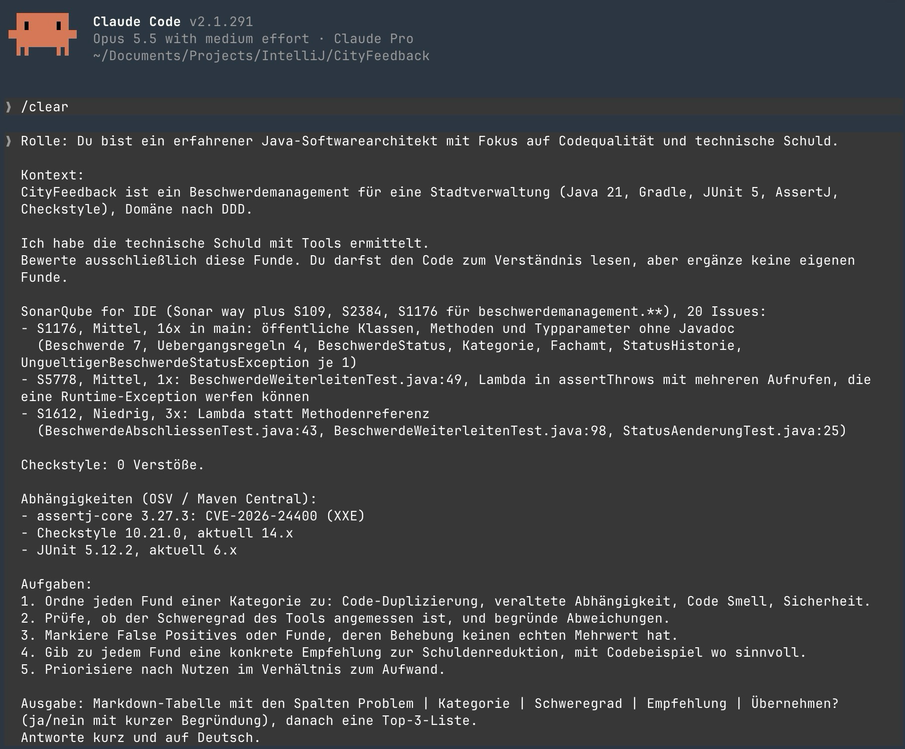

# 3. Technical Debt und Regelverletzungen mit LLM analysieren

**Ziel:** Technische Schuld und Regelverletzungen erfassen, nach Schweregrad einordnen und mit LLM-Unterstützung reduzieren

**Tools:** SonarQube (siehe Teil 1), SonarQube for IDE, IntelliJ Vulnerable Dependencies, Claude Code mit Opus 5.5 (Abfrage Maven Central und LLM-Bewertung)

## Phase 1: Analyse mit Tools und LLM

### 1.1 Ausgangslage aus Teil 1

Die SonarQube-Analyse aus Teil 1 dient als Basis und wird hier nicht wiederholt.
Ergebnis: 0 Issues in Security, Reliability und Maintainability, 0 % Duplizierung, Technical Debt nahe 0, Coverage unter 30 %.
Mit den Standardregeln ("Sonar way") findet SonarQube also keine technische Schuld, daher verschärfen wir die Regeln.

### 1.2 Erweiterte Regeln in SonarQube for IDE

Zusätzlich aktiviert: S109 (Magic Numbers), S2384 (Mutable Members), S1176 (Javadoc für öffentliche API).
S1176 prüft standardmäßig nur Packages unter `**.api.**`, daher wurde `forClasses` auf `beschwerdemanagement.**` gesetzt.

### 1.3 Ergebnisse der Tools

| Regel | Verletzung | Schweregrad | Anzahl | Ort |
|---|---|---|---|---|
| S1176 | "Document this public … by adding an explicit description" (keine Javadoc an öffentlicher API) | Mittel | 16 | `main`, 7 Dateien |
| S5778 | "Refactor the code of the lambda to have only one invocation possibly throwing a runtime exception" | Mittel | 1 | `test` |
| S1612 | "Replace this lambda with method reference" | Niedrig | 3 | `test` |
| **Gesamt** | | | **20** | **10 Dateien** |

Veraltete Abhängigkeiten: Sicherheitslücken meldet IntelliJ unter "Vulnerable Dependencies", die aktuellen Versionen hat Claude Code aus Maven Central abgefragt.

| Abhängigkeit | Version | Aktuell | Befund |
|---|---|---|---|
| `assertj-core` | 3.27.3 | 3.27.7 | Sicherheitslücke CVE-2026-24400 (XXE), CVSS 7.3 (hoch) |
| Checkstyle | 10.21.0 | 14.4.0 | 4 Major-Versionen zurück |
| JUnit Jupiter | 5.12.2 | 6.1.3 | 1 Major-Version zurück |

### 1.4 Prompt an das LLM

### 1.5 Antwort des LLM

Vollständige Antwort: [llm-out/u5-3-antwort-2.md](llm-out/u5-3-antwort-2.md)

| Fund | Schweregrad laut LLM | Übernehmen? |
|---|---|---|
| AssertJ-CVE | niedrig (nur Test-Scope, `isXmlEqualTo` ungenutzt) | ja |
| JUnit 6, Checkstyle 14 | niedrig | ja, als eigene Schritte |
| S1176 Javadoc (16x) | niedrig | teilweise, nur `Beschwerde` und `Uebergangsregeln` |
| S5778, S1612 (4x, Tests) | niedrig | ja |

**Top 3:** AssertJ patchen, Test-Issues beheben, Updates und gezielte Javadoc.

**Anmerkung:** Das LLM ergänzt eine Angabe ohne Grundlage: "Scanner/CI bleiben rot", die CI enthält aber keinen Scanner.

## Phase 2: Auswertung, Bewertung und Einordnung

| Problem | Tool | Kategorie | Schweregrad (Tool) | Schweregrad (LLM) | Bewertung |
|---|---|---|---|---|---|
| AssertJ 3.27.3 (CVE-2026-24400) | IntelliJ (Vulnerable Dependencies) | Abhängigkeit / Sicherheit | hoch (CVSS 7.3) | niedrig | übernehmen, Update auf 3.27.7 |
| JUnit 5.12.2, Checkstyle 10.21.0 | Claude Code (Abfrage Maven Central) | Abhängigkeit | – (kein Schweregrad) | niedrig | übernehmen, je ein eigener Schritt |
| S1176 fehlende Javadoc (16x) | SonarQube for IDE | Code Smell | mittel | niedrig | teilweise, nur `Beschwerde` und `Uebergangsregeln` dokumentieren |
| S5778 Lambda mit mehreren Aufrufen | SonarQube for IDE | Code Smell (Test) | mittel | niedrig | übernehmen |
| S1612 Lambda statt Methodenreferenz (3x) | SonarQube for IDE | Code Smell (Test) | niedrig | niedrig | übernehmen |

**Einordnung:** Kritische Schuld gibt es nicht, Duplizierung wurde nicht gefunden.
16 von 20 Funden sind fehlende Javadoc und damit eher formale Schuld, der einzige Sicherheitsfund ist im Projekt nicht ausnutzbar.
Das LLM hat die Tool-Schweregrade sinnvoll in den Projektkontext eingeordnet, aber auch Angaben ohne Grundlage ergänzt (siehe 1.5).

Die übernommenen Maßnahmen werden in der nächsten Iteration umgesetzt und danach erneut mit SonarQube for IDE geprüft.

## Reflexion

Insgesamt hat sich das LLM (Claude Opus 5.5 über Claude Code) bewährt, als Sparringspartner und zum Entwerfen und Vorformulieren von Texten.
Auch beim Erweitern der SonarQube-Regeln und beim Einordnen der technischen Schuld war es eine große Hilfe.
An einigen Stellen hat es jedoch Aufgaben übernommen, die nicht verlangt waren, oder ungenaue Antworten geliefert.

### Was hat das LLM gut gemacht?

Als Sparringspartner hat es geholfen, das Vorgehen zu durchdenken und Ideen schnell gegenzuprüfen.
Beim Entwerfen und Vorformulieren der Texte hat es viel Zeit gespart.
Beim Erweitern der SonarQube-Regeln und beim Finden und Einordnen der technischen Schuld war es ebenfalls hilfreich.

### Wo waren Grenzen und Fehler?

Im ersten Prompt stand statt des Codes nur ein Platzhalter.
Das LLM hat daraufhin selbstständig das Repo gelesen und 17 eigene Funde geliefert, die mit den Tool-Ergebnissen nichts zu tun hatten ([llm-out/u5-3-antwort-1.md](llm-out/u5-3-antwort-1.md)).
Diese Antwort wurde verworfen und der Prompt auf die Bewertung der Tool-Funde eingegrenzt.
Auch in der zweiten Antwort ergänzt es Behauptungen ohne Grundlage ("Scanner/CI bleiben rot"), obwohl die CI keinen Scanner enthält.
Versionsangaben sind unscharf: Es empfiehlt `junit-bom:6.0.x`, aktuell ist aber 6.1.3.
Jede Aussage zur Ausnutzbarkeit oder zum Projektkontext muss daher selbst am Code geprüft werden.

### Mehrwert für den Prozess

Die Tools liefern vollständige, reproduzierbare Funde, aber ohne Kontext und mit pauschalen Schweregraden.
Das LLM ergänzt genau diesen Teil: Einordnung, Priorisierung nach Nutzen und Aufwand und konkrete Umsetzungsvorschläge.
Die Qualität der Antwort hängt dabei direkt davon ab, wie eng der Prompt gefasst ist und welche Tool-Funde er enthält.
Die Kombination spart Zeit bei der Bewertung, die Entscheidung bleibt aber beim Menschen.
